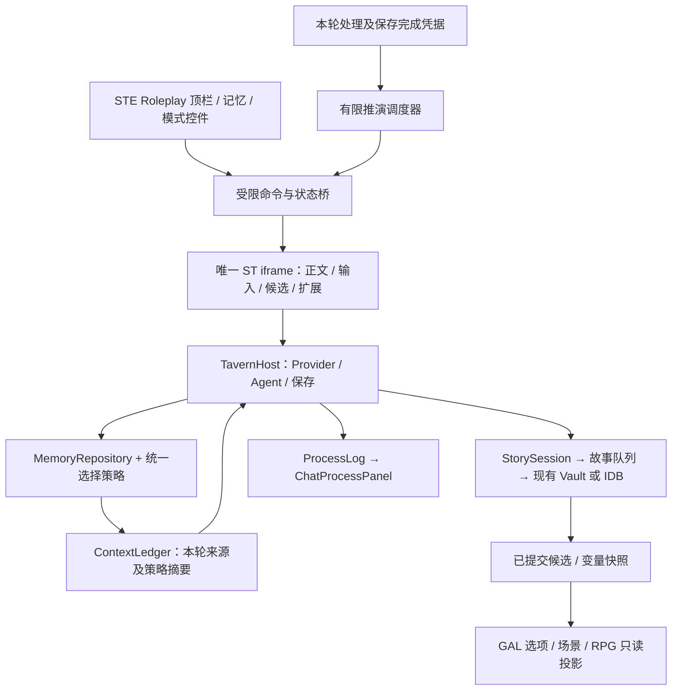
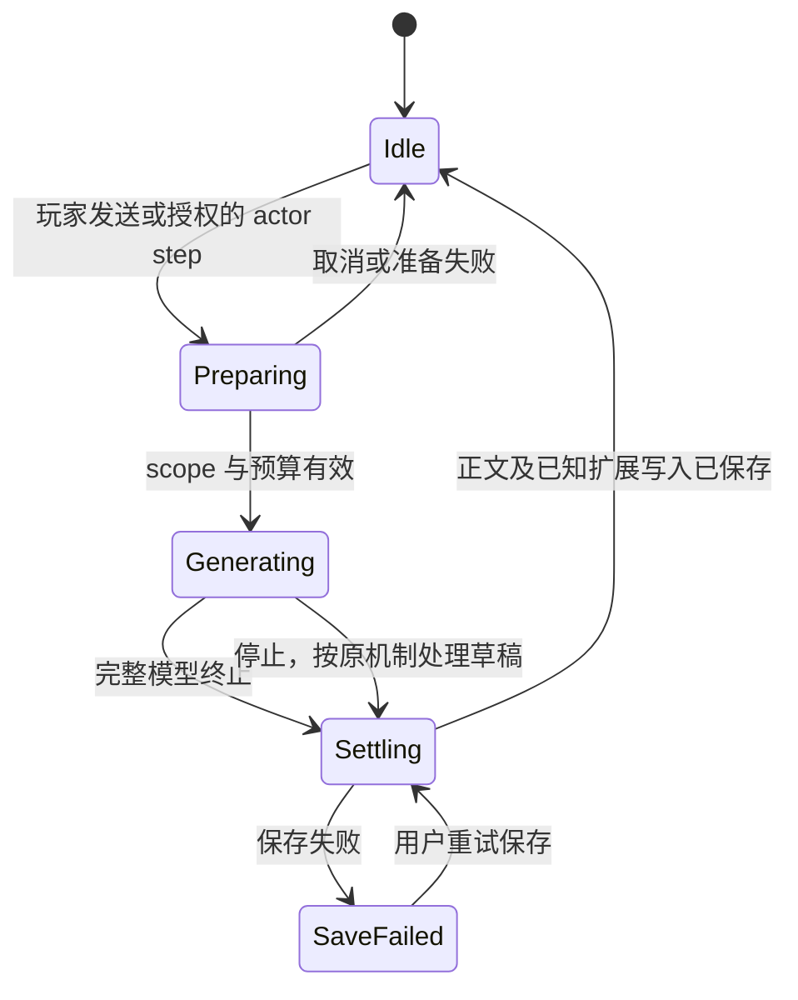

> 历史快照：此文记录两大支柱重规划前的方案/实现；不是当前实施依据。当前方案见 [2026-11-06-multimode-transparent-memory.md](2026-11-06-multimode-transparent-memory.md)。

> 当前状态（2026-11-07）：用户否决本轮成果，两轮实现均已回退。本文仅保留历史讨论，不再是执行依据；此前批准和技术测试不代表游玩体验认可。见[回退记录](../../verification/2026-11-07-multimode-rollback.md)。

# ST Explorer 多态游玩与透明记忆：架构及分批实施草案

> 2026-11-06 联合审查更新：用户确认 D1～D8 采纳推荐，授权 Batch 1a/1b 细化后直接实施。以下“待批准”保留原草案编制语境；当前授权与界面状态以 [Batch 1 实施细节](2026-11-06-batch1-memory-choices.md) 为准。GAL/RPG/Observer 尚未进入实施。新增硬约束包括单行胶囊导航、记忆轻抽屉与卡片流、44px 触控、GAL 遮罩/毛玻璃、HUD 动效；Observer 旁白入口改为收起的悬浮胶囊，用后收起，覆盖本草案中常驻大输入栏的设想。

日期：2026-11-06（Asia/Shanghai）。作者：Codex。审查对象：用户与主 Agent Antigravity。

**状态：提案已编制，等待联合审查；未获实施批准。** 本任务只修改文档与共享阅读档案，不修改产品运行代码、依赖、版本或构建产物。用户已确认在当前仓库交接。审查入口见[审查与技术交接](../../private/maintenance/2026-11-06-multimode-review-handoff.md)。

核对基线：分支 `codex/playtest-20261031`，HEAD `01686330ad5e64b2ec2f90e257dabe813afbf7f1`，`package.json` 版本 `0.9.8`。实际工作区有前批大量未提交修改及新增文件，本文依据**当前工作区代码**，不能仅检出该 HEAD 就假定接口相同。实施前重读 `docs/maintenance/CURRENT.md` 并复核差异。此前 0.9.8 的测试、打包及待补测状态不由本提案改变。

交付前重读发现另一维护会话已完成 SPreset 工具路径补测和启动深色底色补修，最新仍为0.9.8、产物位于 `release/2026-11-06-startup-dark/`。这些是另一任务的成果；本提案保留其新状态，不再把旧的待补测描述当作当前阻塞，也不认领其测试/打包。

## 1. 建议与范围

建议采用“一个聊天运行时，多个展示方式和有限执行策略”。继续由嵌入的 SillyTavern（ST）承担提示词组装、流式生成、正则、原版助手、SPreset、MVU、候选与聊天 DOM；STE 增加展示控制、记忆管理、状态投影和有预算的调度器。标准聊天始终是基础入口。

首批交付透明记忆手动管理、楼层存为记忆，以及无需额外模型调用的快捷选项；随后交付 GAL 和 RPG HUD，再做周期提取，最后实现多角色观赏推演。每批可单独体验与撤下，后批失败不要求用户换掉原聊天方式。

| 能力 | 首个可体验结果 | 后续深化 | 本方案不包含 |
| --- | --- | --- | --- |
| GAL / 选项 | 从明确的选项段提取 2～4 个按钮；点击按玩家输入发送 | 立绘、背景、情绪映射；可选轻量模型补选项 | 自动生图、视频引擎、重新实现富文本与扩展执行 |
| 创造者 / 观赏 | 单步选择发言者、多角色共享场景、旁白事件 | 有限 3～5 轮调度、回复概率、私密记忆、暂停与预算 | 无限后台运行、通用多 Agent 平台、完整 ST 群聊导入 |
| RPG | 绑定已有变量路径，展示血条、等级、背包、任务 | 已保存变量的增减提示、结构化判定面板 | 新数值结算引擎、从正文猜数值后写回 MVU |
| 透明记忆 | 独立面板、逐项启停/编辑/删除、来源与实际使用说明 | 周期事实提取、待确认建议、多角色可见范围 | 向量数据库、云端记忆服务、自动改写角色卡/主世界书 |

InfiPlot、OpenStory、AI 修仙模拟器、PawzoChat 在本文中仅是用户给出的交互参考。本次没有核验这些项目的源码、版本、许可证或性能，不把它们的实现当作已证实的可复用依赖；若未来采用其代码，另核对许可与具体提交。当前方案不需要新增重量级依赖、云服务或部署服务。

## 2. 当前架构与真实复用边界

### 2.1 两个聊天入口不能混淆

`src/pages/Roleplay.tsx` 明确由 STE 管导航及恢复，实际聊天 DOM 全部归 ST；它建立 host、注册到 `frame.ts`，加载 `/tavern.html?host=…`。现有“过程”入口在这里，实际组件名是 **`ChatProcessPanel`**，不是泛称的 `ProcessPanel`。

`src/components/chat/ChatWorkbench.tsx` 则是聊天处理页与故事工作区共用的阅读/编辑组件，父页持有 session 和持久化。不能把它直接当成实时发送组件，也不能新增一个 React 消息列表后同时运行两个聊天正文渲染器。故事卷宗、阅读、搜索、编辑、收藏、分支和返回路径原样保留；本方案的四种游玩展示只挂在 `/play/:id`。回顾页可新增“存为长期记忆”动作，不承担自动推演。

### 2.2 代码映射

下表路径均相对仓库根目录；“新增”均为拟议文件，并非当前已有能力。

| 当前模块 / 接口 | 已核对的事实 | 本次复用或扩展 |
| --- | --- | --- |
| `src/pages/Roleplay.tsx`、`src/lib/roleplay/frame.ts` | 保活 iframe；导航前保存；关闭会释放 host；跨故事可重建 | 顶栏展示切换与记忆入口，复用关闭/保存失败恢复；新增受限模式桥 |
| `src/tavern/host-bootstrap.js` | 连接 ST 与宿主；盖章稳定消息/候选 ID；已有玩法、文件记忆编辑入口 | 拆出展示桥、楼层记忆动作与发送适配，不再继续膨胀同一文件 |
| `scripts/tavern/host-overlay.mjs` | 从固定上游生成集成层，替换位置失配会报错 | 必要时加窄接缝；不直接修改固定上游或生成目录 |
| `src/lib/roleplay/tavern-host.ts` | 路由请求、保存、模型、Agent、世界书、扩展；配置响应目前 `groups: []` | 暴露领域快照与受限命令；后批新增群组/群聊路由，不能声称群聊已有 |
| `story-session.ts`、`archive-db.ts` | `openStorySession.save()` 在故事队列内检查版本；`StoryCommit` 带前后 session | 唯一聊天提交链；生成/点击/旁白/推演均走这条链，不直接另写 JSONL |
| `live-chat.ts`、`fingerprint.ts` | 保留 ST 原始字段、候选；`SourceRef` 含 messageId、candidateId、正文/历史摘要 | 选项、HUD、记忆、事件绑定具体候选；禁止用楼层数组下标当身份 |
| `memory.ts` | Markdown 真源；`list/read/commit/inheritanceFiles`；digest、journal、来源失效、手动保护 | 扩展条目元信息和删除/启停事务；保留既有文件记忆 |
| `agent-runtime.ts`、`tool-agent.ts` | 回复前选资料，成功采用并保存后维护记忆；`classic/agent` 与维护者约束 | 在资料检索与提交层做统一过滤；周期提取接入原维护链 |
| `context-ledger.ts` | 历次 adopted supplement 可冻结复用；`reserve()` 计预留；支持 reset | 记忆策略变化必须失效旧补充；增加来源清单及策略摘要 |
| `runtime-store.ts`、`paths.ts` | 桌面故事目录文件；Web/Android `roleplayFiles` IDB；路径只允许 memory 和 .ste-control/roleplay 下分支目录 | 新配置走同一逻辑路径；不引入全局第二数据库，不嵌套故事锁 |
| `branch-inheritance.ts`、`story-package.ts` | 来源约束继承；完整故事包携带受限数据文件，省略可执行配置 | 显式新增配置/条目继承及导出政策，不能指望现有白名单自动包含 |
| `src/components/VariableInspector.tsx`、`src/lib/variable-inspector.ts` | 变量树、JSON Pointer 路径、差异；2500 节点/40 层界限 | 路径选择/排错复用组件；HUD 用有界选路投影，不重复整树遍历 |
| `src/lib/frontend-workbench.ts:frontendSnapshot()` | 读取楼层指定候选变量，不把缺值误回退为当前候选 | 抽出共用候选变量读取；诊断预览与真实运行快照保持分别标记 |
| `src/components/roleplay/ChatProcessPanel.tsx`、`process-log.ts` | 内存最近 20 轮；详情截断/脱敏；模型完成与保存事件分别记录 | 加选项、记忆选择、推演预算摘要；日志不是业务事件总线或变量真源 |
| `src/components/chat/FloorProcessingMenu.tsx`、`ChatWorkbench.tsx` | 楼层处理与收录；`recordContext.flush` 可先保存编辑 | 新增存记忆入口；复用交互样式，不把总结/日记仓库当运行记忆 |
| `src/lib/portrait-store.ts`、`portrait-preview-cache.ts`、`character-portrait-cache.ts` | 立绘 ID/行及桌面文件或 IDB 图片；已有有界缓存 | 绑定已有立绘，按需解码；背景走受限媒体适配，不复制全库 Base64 |
| `src/hooks/use-viewport.ts`、`ui/sheet.tsx` | mobile <768、tablet 768～1023、desktop ≥1024；已有抽屉 | 复用断点、焦点管理与手机返回，不另造一套导航 |

### 2.3 关键缺口

1. 现有文件记忆已有“查看/修改”弹窗（`host-bootstrap.js`），并非完全不可见。本次主要改善逐条管理、时间/重要性、实际注入解释及入口可达性。
2. `MemoryDocument` 当前没有 enabled/deleted、重要性或角色可见范围。`manual` 提交会清空 sourceRefs；从楼层手动存记忆不能直接照搬这项语义，否则丢失证据且在分叉后误继承。
3. `context-ledger.ts` 会继续带入已冻结补充。仅在列表里隐藏禁用项，不能保证下一轮停止使用该记忆。
4. 原生 Agent 和柏宝书目前互斥：`agent ⇒ native-agent`，`classic ⇒ none | baibai`。新展示模式不得改动这项运行配置；两者的编辑失效保证不同。
5. `ProcessLog.finish(succeeded)` 在模型响应结束时调用；`MESSAGE_RECEIVED`、插件处理、变量写入和保存可能更晚。不能订阅这个状态就开始下一次自动回复。
6. 群聊导入不在现有结构化导入范围。`groups: []` 也说明宿主接入不完整；多角色是最大新增工作，需单独验收。

## 3. 目标架构：展示、执行、记忆三条轴



展示选项 `standard | gal | observer | rpg` 与现有 `RuntimeConfiguration.mode: classic | agent` 使用不同类型和字段名。Observer 是“展示 + 显式启动的控制面”，切进 Observer 只展示控制栏，不自动发请求；GAL/RPG 也不隐式启用工具模型、记忆维护或脚本。

### 3.1 展示实现选择

| 方案 | 代价与兼容性 | 建议 |
| --- | --- | --- |
| 保留 ST 消息节点和生成链，模式适配器改布局，React 提供周边面板 | 对 ST CSS/虚拟列表有少量接缝，需真实扩展回归 | **采用** |
| 用 React 重绘全部 ST 消息和输入，host 仅作后端 | 需复制正则、脚本/iframe、候选、宏、流式及事件行为 | 不采用 |
| 将既有 HTML 成品当作每种模式模板 | 部分作者卡方便，但任意 HTML 无法提供统一安全命令、状态恢复和取消保证 | 作为兼容内容保留，不作为模式底座 |

具体分工：`Roleplay.tsx` 及新增 `PlayModeBar/MemoryPanel/RpgHud/ObserverControls` 用 React；`src/tavern/play-mode-bridge.js` 和作用域 CSS 调整 iframe 内现有 ST 容器。GAL 的对话仍是 ST 原消息节点，立绘/背景在专属舞台容器，选项按钮可在独立挂载点呈现，但不把消息 `.innerHTML` 复制到 React。跨 iframe 样式不假定继承 Tailwind；新增样式显式打包到固定集成层。

GAL 显示当前楼，提供历史入口回到同一个原列表；未显示的历史以 ST 已有虚拟列表/窗口机制管理，不能对其测量根容器直接 `display:none`，不能为每楼新建第二个扩展 iframe。切回标准时移除模式样式并恢复阅读锚点。若某卡依赖标准布局或桥能力缺失，保留其原消息展示和可点击的“返回标准”；不能静默丢掉 HTML、按钮或脚本。任意第三方 DOM 假设无法保证在沉浸布局中都成立，兼容目标是其标准路径完整可用，并逐项记录新模式验证范围。

### 3.2 建议的模式桥契约

以下为设计伪接口，尚不存在；实施时优先复用现有 host 注册，不再搭一套通用 RPC 服务。

```ts
type PresentationMode = 'standard' | 'gal' | 'observer' | 'rpg';
interface PlayScope {
  vaultEpoch: number; hostInstanceId: string; selectionEpoch: number;
  storyId: string; branchId: string | null;
}
interface CandidateAnchor {
  messageId: string; candidateId: string; contentDigest: string; historyDigest: string;
}
interface PlayBridge {
  capabilities(): { presentation: PresentationMode[]; groupStep: boolean; settlement: boolean };
  snapshot(): PlaySnapshot; // 有界、不可变、稳定引用；不是完整聊天副本
  subscribe(listener: () => void): () => void;
  setPresentation(mode: PresentationMode): Promise<void>;
  submitPlayerText(cmd: { scope: PlayScope; operationId: string; anchor: CandidateAnchor;
    text: string; origin: 'composer' | 'choice'; literal: boolean }): Promise<CommandReceipt>;
  stepActor(cmd: ActorStepCommand): Promise<TurnReceipt>;
  queueNarration(cmd: NarrationCommand): Promise<CommandReceipt>;
  stop(runId?: string): Promise<void>;
}
```

边界要求：host 校验 scope/长度/枚举/候选指纹，所有命令带 operationId；同一次点击不会重复生成或保存。禁止由 UI 传模型密钥、任意端点、原生路径或任意 JS。选项默认 literal 文本，开头 `/` 不得变成 ST slash command。用户自己的输入框仍沿现有行为处理。

operationId 的幂等性不能只靠禁用按钮：由桥给新增玩家/旁白消息的独立 `extra.ste_play` 元数据记录 operationId、origin/choiceId，保留原 `ste_runtime` 身份字段；已派发角色回合亦绑定 runId/stepId。保存入口在同一故事锁中查当前正式消息和受限命令回执再决定是否追加。正文保存成功而回执写入失败时，重读正式消息修复回执，不能重发模型；重开不自动重放 pending 命令。该元数据仅是控制来源，不是第二份正文。

React 订阅用现有 `useSyncExternalStore` 模式；snapshot 只在版本变化时换引用。ST 模式桥只读公共状态并调用可核验的公开入口；需要导出非公开接缝时修改 `host-overlay.mjs` 并加固定上游检查。卸载解绑 listener、释放媒体 URL；在关闭 host 前停止调度器。

### 3.3 状态机与切换规则

不要用一个大枚举把展示、请求、保存及后台记忆揉在一起。建议以 reducer 和纯函数表达相互独立的状态，不新增 XState/Zustand 等依赖。

| 状态轴 | 值 | 持久化 |
| --- | --- | --- |
| 展示 | standard / gal / observer / rpg；requested 与 applied 分开 | 分支偏好保存，失败回 standard |
| 聊天轮次 | idle / preparing / generating / settling / save-failed | 正文由既有 session/draft 保存；运行态不重启续跑 |
| 推演 | idle / running / pause-requested / paused / stopping / completed / failed / interrupted | 仅保存配置与有限回执；重开只能手动继续 |
| 辅助任务 | choices、memory-extraction 各自 pending/running/done/failed/cancelled | 候选/提案可恢复，网络任务不自动重发 |
| 导航 | active / parked / switching / closing | 沿现有 Roleplay 生命周期 |



| 触发 | 行为与必须保留的状态 |
| --- | --- |
| 空闲切展示 | 原 host/iframe/消息节点身份不变；保留输入草稿、当前候选、滚动锚点与扩展状态；不发网络请求 |
| 流式期间切展示 | 立即记录目标与提示“本轮结束后切换”；到完成边界再应用，避免移动正在执行的 HTML 节点 |
| Observer 切到其他展示 | 先停止安排新 actor step，当前轮按“暂停/立即停止”语义收尾；切回来仍为 paused，不暗中恢复 |
| 切故事/分支/库 | 取消候选任务与推演；scope epoch 更新；先复用原 flush/保存失败恢复；迟到回包不能写新目标 |
| 模块返回、窗口失焦 | 普通手动聊天沿现有后台行为；推演停止排下一步，当前轮可收尾；Android 真正挂起按 interrupted 恢复 |
| 选择其他候选、编辑/删除来源 | 选项失效；HUD 重基线不播放“奖励”；记忆重新校验；推演先暂停 |
| 断网/重开 | 恢复已经保存的正文、布局与提案；无定时器/网络自动重启 |

### 3.4 “本轮完成”不是网络完成

新增 `TurnReceipt` / `turn-settlement.ts`，不能从 ProcessLog 文案推断。凭据至少包含 scope、turnId、候选锚点、正文提交版本、变量版本和已知扩展的完成状态。

进入下一轮须同时满足：模型完整终止；已绑定当前采用候选；ST 生成状态空闲；SPreset 工具结果已变成最终正文或明确失败；原版助手/MVU 已知写队列完成；故事保存成功。需要下一角色马上读记忆时，再等待本次记忆维护完成或明确进入“记忆待补全”并暂停推演。

可复用 `waitForGenerationIdle`、helper flush、`flushDebouncedChatSave`、host flush 的内部步骤，但**不能每步调用现有 `__STE_TAVERN_FLUSH__`**，因为它会主动 `stopGeneration()` 并提交设置。应拆出不主动停止的受限 settle 流程，保留原关闭流程语义；也不能在 `MESSAGE_RECEIVED` 的同步回调内等待依赖同一事件链的 Promise，避免自等死锁。

对扩展不暴露完成标记的场景，提供有期限的适配器等待；超时显示“扩展完成状态未确认”，自动推演暂停，可由用户手动继续。静默等待 500ms、固定 sleep 或一个 `GENERATION_ENDED` 事件都不是一致性证明。已有 `process-events.js` 已处理结束事件早于消息绑定的情况，新逻辑必须保留该顺序。

## 4. 三种专精模式

### 4.1 GAL：先选项，再舞台

**Quick Choices 优先级**：用户设置或已识别的结构化选项 → 回复中明确的“行动选项”段 → 用户开启后的一次小模型补全。没有可靠选项就显示“自己输入 / 生成选项”，不把正文普通编号列表误当行动，不虚构默认选择冒充模型建议。

首版解析明确可配置标记块或 `choices: [{label, text}]` 结构；只接受 2～4 个非空、去重、长度受限的纯文本（建议 label ≤40 字符、text ≤240 字符）。HTML、脚本、工具调用、路径和 URL 不作为可执行动作。原正文保持不变；若隐藏选项块，只做可关闭的显示投影，不改存档。

`ChoiceSet` 保存来源 scope/SourceRef、生成策略版本、可选模型 ID、选项正文、状态与 operationId。缓存键包括候选/正文摘要与策略；新候选、较早楼层编辑或新一轮输入会使旧按钮不可发送。点击通过 `submitPlayerText` 提交“追问实情”等实际玩家文本，不发送 UI 编号；点击后同组立即锁定，失败可重试同 operationId，若已落库则不能再添加一条玩家输入。当前输入框已有草稿时，按钮改为“填入”，保留草稿并让用户发送，避免覆盖文字。

模型补选项在主回复完成并保存后启动，允许与本地显示并行，但不与尚未落定的 SPreset/MVU 处理抢跑。若与记忆提取同时触发，统一辅助队列优先选项，最大并发 1；用户发送下一轮就取消过期选项。默认不开额外调用；可配置“无结构化选项时自动补全”，每个已保存候选最多一次，重新生成需显式点击。辅助失败不改变主回复成功状态。

舞台资源使用 `SceneBinding`：角色 ID + 立绘行/条目 ID、背景媒体引用、条件映射、优先级与 fallback。优先级为“用户固定 → 显式 MVU/作者标签映射 → 默认图”。首版只支持枚举匹配、数值阈值和布尔条件，不接受可执行表达式；缺图/标签未知回退头像或纯背景。情绪不靠每帧调用模型，后续可把明确结构化情绪随既有辅助结果返回，仍非强制。

背景支持本地图片切换和轻量 CSS 过渡；动态效果首版不引入视频、Live2D 或粒子引擎。已有外部素材可继续按用户资源设置访问，离线时保留本地图/占位，不把外链可用当成离线保证。

### 4.2 RPG：变量投影与叙事分流

`RpgHudSchema` 是展示配置，非新的世界状态。每项绑定 `scope: message | chat`、RFC 6901 JSON Pointer、显示类型 `bar | number | text | list | relationship | quest`、label、可选 maxPath/单位/排序/列表上限。示例：`message:/stat_data/主角/气血` 与 `/stat_data/主角/气血上限`；路径必须经用户或卡作者明确配置，不能假定所有卡都使用同名 schema。

从选定候选的 `rawData.variables[swipe_id]` 或相应候选 extra 中读取，chat 变量另取 `rawMetadata.chat_metadata.variables`；复用 `frontendSnapshot` 的候选缺值规则。字段缺失显示“未配置/当前候选无值”，不能显示 0 冒充真实状态；区分 null、缺失、NaN、字符串数值和数组。血条仅对展示比例夹值，不修改底层变量；整数/小数单位由映射决定。

已保存 `StoryCommit` 提供正式快照；已知 MVU 事件可先显示“更新中”的临时数值，成功 flush 后确认并播放一次差值。保存失败则清楚标记未保存，不播放确认奖励。delta 的键为候选 ID + 变量版本 + 路径；重开、模式切换、翻历史和切候选只换基线，不重复“修为 +100”。兼容层若只能观测落盘，动效在落盘后触发，并标明该范围。

复用 `VariableInspector` 做“选择路径 / 查看原值 / 差异”，常驻 HUD 只读已绑定路径，每次提交一次有界投影。展示任务/物品列表用既有虚拟列表库或分页，建议首屏 20 项、展开上限 100；每组最多 12 个字段、最多 4 组，超出需明确展开，防止遍历数万节点。

判定流仅收纳有可靠来源的结构化事件，例如作者明确标签的判定区、受支持骰子结果或 MVU patch 回执；保存 `kind/来源/候选/摘要/原始位置`。优先以“判定摘要卡 + 查看原文”呈现；首批不自动从普通文学段落猜硬判定，也不删除正文。后续对明确标记的区块可折叠为同一 DOM 中的判定区，未知 HTML/脚本仍按原渲染路径显示。骰子结果究竟来自本地规则还是模型叙述要标清，不能将模型编造的数字称作引擎判定。

### 4.3 Observer：先可靠多角色，再有界自主推演

房间定义为**一个故事分支的多角色场景**，新增 branch-scoped `RoomConfig`，不另建第二套聊天真源。故事原绑定角色仍是资料归属；参与角色保存独立稳定 actorId、引用 characterId、可选模型配置引用、发言权重、禁用状态。角色卡与主绑定/额外世界书从既有资产链读取，冻结本轮快照，不改源卡。

建议复用固定 ST 上游群聊的消息/提示词语义，补 STE 的 group catalog 与 `/api/groups/*`、`/api/chats/group/*` 所需宿主路由。以实现前固定上游实际调用清单为准，未支持路由明确失败；不能返回空成功骗过 ST。第一步只支持 STE 创建的房间，不宣称可导入或写回全部外部 ST 群组。映射到 `openStorySession`，保留角色 `name`、`force_avatar`、群聊原始标识，并在 STE 元数据记录 actorId；不能只依赖可重名的角色名。

每个 actor step 调用 ST 的“指定角色生成一次”语义，关闭 ST 自身 automode，防止两个调度器同时驱动。若固定上游没有可独立调用的接口，在 overlay 加可检查的导出；不得用切换另一个单聊故事的方式串联，也不直接全局替换 `{{char}}`。Batch 5a 对单步群聊不通过时，Batch 5b 不启动。

现有 runtime 以故事/分支 locator 为键，房间新增 actorContextId 不能直接复用上一个角色的 pending turn、world scope 和补充。建议仍保持一个分支写入者，每次串行 actor step 捕获 actorId/cardDigest/worldScopeDigest，所有上下文与维护回执都携带它们；角色变更使 ledger 周期失效。可按角色保存独立 ledger 子目录优化缓存，但首版无需此复杂度。角色删除或配置改变发生在运行中时先暂停，不能按同名替补角色继续。

**隐私范围**：本轮角色 A 仅能检索 A 的私有记忆、公共场景记忆及本轮允许的共享资料；B 的私有记忆不得出现在工具索引、search/read 返回、摘要、旧 ledger supplement、最终请求或 A 的世界书投影中。房间共享聊天记录本身默认公开；不能向用户承诺对记录中已说出的秘密再做隔离。私有记忆是角色上下文隔离，不是磁盘加密，用户在管理面板仍可查看全部。

预设若将所有角色完整描述合并进上下文，可能泄露卡内秘密。Observer 首版采用逐角色上下文策略，显示本轮角色与公共资料范围，关闭“合并全部卡片私有内容”的路径；不能证明可见边界的扩展组合禁止自动推演，标准单聊仍可用。不得为隔离偷偷删改原卡。

**轮数定义**：一次“轮”遍历本轮候选角色名单；每人最多发言一次，每轮默认最多 2 次角色回复。默认 2～4 名角色、3 轮，硬上限 5 轮/10 次角色回复（建议初始产品上限）。回复概率在每人本轮只有一次抽样，未命中直接跳过，不重复抽到有人回复；全部跳过即暂停提示。概率只降低期望成本，硬上限才限制最大成本。

初版调度不用模型挑下一位：采用稳定轮询 + 可配置概率/权重，seed 与抽样结果仅作本地复现记录。禁止同一角色连续垄断，用户可“指定下一位 / 单步 / 开始 N 轮 / 本轮后暂停 / 立即停止”。第一版不允许角色生成多个自主工具子角色。

```ts
interface AutoPlayLimits {
  rounds: number; maxReplies: number; maxRepliesPerRound: number;
  maxProviderCalls: number; maxEstimatedTokens: number; maxOutputTokensPerReply: number;
  deadlineMs: number; stepTimeoutMs: number; maxConsecutiveFailures: number;
}
// prepare → reserve budget → dispatch ONE actor → settle → commit receipt
// → settle required memory → test pause/event/budget/scope → select next actor
```

旁白输入常驻顶部：提交后进入 FIFO 事件队列，在当前回复完成、下次角色准备前，按原 ST narrator 消息语义追加并保存一个可见楼层，不伪装成最高优先级 system 指令。事件文本不执行 slash/JS。事件带 operationId、作用域、来源用户、应用轮次；正文保存成功才标 applied，重启核对同 ID 避免重复插入。默认“下一角色前生效”；如需立即影响，用户先“立即停止”当前轮，再提交。未提交的输入是草稿；已排队未生效的事件可取消，已生效需编辑或分叉。

出错、保存失败、权限不明、模型结束异常、工具超预算或扩展完成不明均暂停，不自动重试网络调用。停止 abort 当前请求及辅助任务，释放预算占用但保留已实际消耗；部分正文按现有草稿机制处理。重开将未终结 run 标 interrupted，用户看到最后保存位置与剩余上限后才能继续。

## 5. 透明记忆：可管理、可解释、可失效

### 5.1 面板与使用闭环

顶栏“记忆”与“过程”并列；原玩法设置的“查看/修改记忆”跳到同一面板，避免出现两个编辑源。桌面是可固定的右侧面板，390px 为全屏 Sheet；保存按钮留在面板底部，正文可滚动，软键盘弹出后仍能保存/返回。

面板按当前故事/分支加载，提供“场景公共 / 指定角色 / 待确认 / 已失效 / 已删除”筛选；时间、关键词和重要性排序。角色筛选默认仍局限当前故事，**不把同一角色在其他故事的经历自动串进来**。未来跨故事知识需另行显式分享，当前不建立全局角色记忆库。没有房间时，公共范围就是当前单聊分支。

每项展示启用勾选、标题、正文摘要、来源楼层/候选、作者/维护者、修改时间、重要性、可见对象及状态。详情可直接编辑、删除、恢复，点击来源回原楼层；无时间的旧文件写“时间未记录”，不能用迁移时间冒充剧情发生时间。`enabled` 不等于“已入本轮请求”：状态区另示“本轮已用 / 未匹配 / 超预算 / 失效 / 角色不可见 / 当前维护者不使用”。

从实时楼层菜单和 `ChatWorkbench/FloorProcessingMenu` 执行“存为长期记忆”：先 flush 该入口的正文编辑，再读取具体候选 → 选择原文摘录或自行概括 → 调整范围/重要性 → 保存。默认不调用模型，手动条目也保留证据来源；“AI 提炼”是独立可选按钮，显示将发送的范围及预算，产物先待确认。现有“收录为总结/日记”照常保存原记录，不隐式变成模型记忆。

### 5.2 数据结构与兼容读取

继续以 `memory/<branchKey>/…md` 为真源。新增条目采用 `entries/<UUID>.md`，一文件一条，便于人工打开。旧 `state.md`、`style.md`、`characters/*.md` 原样作为“旧文件条目”显示，开关与编辑作用于整个文件；不以标题切分或首次加载就重写全部旧记忆。用户选择“拆为多条”时才预览并原子化逻辑提交。

```ts
interface MemoryEntryMeta { // frontmatter schema 2，拟议
  id: string; revision: number; title: string;
  owner: 'agent' | 'manual';              // 谁可以覆盖正文
  enabled: boolean; deletedAt?: number;  // 删除为 tombstone，可恢复
  approval: 'pending' | 'accepted';
  importance: 0 | 1 | 2 | 3; tags: string[];
  audience: { kind: 'room' } | { kind: 'actor'; actorId: string };
  sourcePolicy: 'tracked' | 'pinned';
  sourceRefs: SourceRef[];               // 所属故事/分支由仓储 scope 确定
  createdAt?: number; updatedAt?: number;
  recordedAt?: number;                  // 外部文件首次登记，非伪造创建时间
  origin: 'manual' | 'floor' | 'extractor' | 'legacy';
  operationId: string;
}
// effectiveStatus 由来源有效性、冲突和 tombstone 计算，不让模型自行宣布 active。
```

正文来源与编辑所有权分离：手动修改改成 owner=manual，但保留 tracked 来源；换候选或改前文仍会失效。用户可明确改为 pinned（“固定设定，不随正文失效”），保留原 evidence 展示并记录选择。pinned 不能突破角色可见范围。旧 manual 无 sourceRefs 的文件保持旧语义，标为“旧手动设定”；从过去楼层分叉时展示“按分叉时现有手动设定复制”，不能假装这是过去时间点的设定。

更新 `MemoryChange` 时应区分正文修改和控制属性修改。启停、重要性、删除不把 agent 文本变成 manual；真正改正文才触发用户所有权保护。模型不得设置 enabled、deletedAt、approval、audience 或清除 tombstone，不能悄悄复活用户删掉的记忆。

新 `MemoryRepository.mutate` 建议接收 `{ operationId, expectedDigest, kind, patch }`；`create/update/set-enabled/delete/restore/accept` 统一进入现有故事队列与 journal。保留旧 `commit()` 适配用于现有工具 Agent，但所有入口都要执行同样元数据校验，不能形成一个旧 API 绕过开关的后门。发生冲突先重读，再显示对比；不无条件 last-write-wins。

### 5.3 删除、恢复、事务与迁移

一键删除写 tombstone，立即从检索/注入/自动维护候选中排除，提供撤销和“已删除”页；正文保留在原文件及可恢复日志，用户说明中明确这是可恢复删除。彻底擦除正文涉及 journal、提案、快照及导出副本，另提供明确列出影响范围的清理操作，不能将 UI 删除宣传为安全擦除；不自动重用 STE 文件库 30 天回收逻辑去删除用户外部 ST 文件。

复用当前 journal 的 prepared/committed/conflict 恢复，但扩展元信息序列化须保留未知 frontmatter。列表读取目前可能执行 recover 并重写 `index.md`，不应视为纯只读；应把 index 当可重建派生缓存，未变化不写，面板筛选不触发全目录重建。条目集合与策略摘要在同一故事锁下读取；不要持有故事锁发网络请求，网络回来再带 digest 重验提交。

迁移只在明确保存/控制时写该文件 schema 2；首次展示通过兼容读取补默认值：enabled=true、accepted、普通重要性、room、旧作者保护与既有来源规则。新增可修改策略前记录备份/迁移版本。损坏或未知新 schema 保留文件并禁用自动注入，显示诊断，不能当空库覆盖。

**旧版回退边界**：0.9.8 旧读者不理解 enabled/audience/tombstone，不能保证它不会读取已禁用或私有条目。支持的是“新版本读取旧数据”，不宣称旧二进制可安全执行新记忆策略。回退应使用升级前的库副本，或由新版本显式导出不带新规则的兼容副本并列出损失；不能在同一库上来回启动旧版并宣称隔离仍有效。

### 5.4 选择与注入必须在一处解释

新增 `memory-selection.ts`，统一返回 `MemorySelectionReceipt`：作用域、actorId、策略摘要、每个条目 ID/revision/digest、included/excluded 原因、预算与实际选中片段。过滤顺序固定：

1. 当前库/故事/分支与房间范围；参与者身份和角色可见性。
2. 未删除、已接受、enabled；冲突及失效来源排除。
3. 当前回合来源截点，防止未来楼层事实进入过去分支。
4. 明确固定项优先，随后关键词/标签命中、重要性、时间、ID 稳定排序；总预算内装配，固定项超预算也要解释，不能偷偷突破窗口。

Agent 模式保留“每轮主流程中选择资料”的现有语义：工具 Agent 只能看到经过上述过滤的资源，search/read/最终 reference 都重新校验资格。native 自动维护可读取失效条目做重提炼的现有能力，仅限被允许的角色范围；禁用/已删/待确认项不作为事实注入，也不允许无痕改写用户删除决策。为避免重复复活，只向提取器提供不含正文的已删来源指纹/去重约束，或在本地提交时拦截对应提案。

| 当前运行配置 | 新面板能做什么 | 注入与自动提取建议 |
| --- | --- | --- |
| classic + none | 管理手动/历史 native 文件 | 默认不改变请求；用户显式启用“使用已选手动记忆”后用确定性选择，无工具调用，无自动提取 |
| agent + native-agent | 管理现有文件、逐条控制、查看主流程选择依据 | 复用 `runToolAgent`，统一过滤；增加每 N 个成功保存回复提取的策略 |
| classic + baibai | 展示归属、原插件入口、可核验摘要概览 | 柏宝书继续负责；原生文件不重复注入。首版不直接修改 `bbs_leaf`，不把其状态冒充 native 保证 |

上述 classic 手动注入是**新增且默认关闭**的独立设置，不偷偷改变 `memoryOwner:none` 的“不自动维护”语义；启用后在 `prepareCompletion` 与最终后处理之间加入一个确定插槽，参与 token 预留和最终请求日志。对没有启用任何新功能的旧故事，最终请求结构与内容必须与基线一致。

**开关的生效时刻**：已发出的模型请求无法收回。生成中编辑可保存，界面提示“下一轮生效”；旁观调度在下一轮准备前重新读策略。真正内容/开关/范围变化产生新的 `memoryPolicyDigest`，由当前快照的有效正文摘要、属性、来源有效性和 audience 计算，而非只信一个可遗漏更新的计数器。即使用户在磁盘改文件，也不能复用旧策略摘要。

`ContextLedger.prepare` 增加策略摘要和角色身份到可复用条件。策略变化或 actor 切换时重建上下文周期，旧 supplement 不再注入；历史回执仍供审计，不改历史已发请求。纯编辑重要性也可能改变入选集合，应在下一轮重新选择。禁用后原故事正文里仍存在同一事实是正常的，应区别“未注入这条记忆”与“模型完全不知道这个事实”。

`MemorySelectionReceipt` 展示候选与实际选择，真正实际请求以 host 最终快照为准；工具 Agent 读过某文档不等于最终引用了它。引用正文及 token 统计按当前上限脱敏，ProcessPanel 可链接回面板；为证明长期来源保留轻量 receipt，不能只靠内存 20 轮日志。

### 5.5 周期提取与分支一致性

默认建议每 5 条成功保存的 assistant 回复提取一次（Observer 每轮末按同一计数汇总，不能又多触发一套）；只提交从上个完成游标至当前候选的增量，窗口建议 ≤8 楼/约 4000 输入 token，最多 8 条事实/约 600 输出 token。窗口装不下时记录待提取范围，不无声跳过。手动“提取至此”与后台提取共用去重键。

提取游标记录最后处理的 SourceRef/区间及策略版本，只有提案持久化成功才前进；批准/拒绝状态另存。每条提案有 evidence refs、文本、建议重要性、目标范围、置信说明（非真实概率）。事实、约束与推测分开，默认仅事实/明确约束；不能从情绪推断“永久关系已经确定”。建议模式默认待确认，可由用户开启“低风险新增自动接受”；模型永不直接覆盖手动条目，有冲突保留两个版本供选择。

新旧维护不能同时对同一候选运行：复用 `agent-runtime.ts` 现有 afterCommit、maintenance 队列及 resume 回执，在其内部增加 cadence 和 proposal 状态。不要另挂一个“回复完成监听”产生第二次总结。已有用户的自动维护策略保持兼容默认，新的周期策略经设置选择后生效，不能升级时偷偷改掉其现有行为。

| 历史变化 | 记忆/提案/显示的处理 |
| --- | --- |
| 同楼换候选 | 按 candidateId 与正文/历史摘要失效；切回原候选可恢复仍有效的条目；不自动再次发提取请求 |
| 改早期楼层或隐藏状态 | 按现有 historyDigest 重新校验；后续依赖项失效，不按 ID 存在就放行 |
| 从过去楼分叉 | 复用 `inheritanceFiles`，只复制截点前有效 tracked 内容；pending、未来来源、执行中的 run 不继承 |
| 手动固定设定 | 显示按分叉时当前设定继承，非历史回滚；禁止把删掉的条目经旧 journal after-image 复活 |
| 删除原楼/故事/分支 | source 缺失失效；取消相应任务；不重新创建已删除故事 |
| 外部编辑与并行保存 | digest 比较失败保留双方，生成新 operationId 重读重提；不覆盖较新用户文字 |

分支继承需同时审查当前 `memory.ts` 从历史 committed after-image 选择旧版本的逻辑：它不能绕过最新 tombstone/disabled/私密范围。继承后的副本独立维护，父子分支互不写回。

## 6. 持久化、导入导出与权限边界

| 数据 | 拟议位置（故事目录相对路径） | 生命周期/分享政策 |
| --- | --- | --- |
| 原有聊天和变量 | `故事.json` / 既有分支 session；JSONL 派生 | 唯一聊天真源，未知 ST 字段保留 |
| 原有运行设置 | `.ste-control/roleplay/<branchKey>/settings.json` | 保留 classic/agent 语义 |
| 模式偏好、场景、HUD 映射 | 同目录 `play-settings.json`、`scene.json`、`hud.json` | versioned schema；引用资产 ID；分支复制需更新白名单 |
| 房间配置 | 同目录 `room.json` | 参与角色与世界书引用；不得包含密钥；分享时校验引用闭包 |
| 记忆条目 | `memory/<branchKey>/entries/<UUID>.md` 或原旧文件 | 真源；新规则与来源见上节 |
| 控制/恢复记录 | 原 memory-journal；同目录 `memory-proposals/`、`memory-receipts/`、`autoplay/` | 容量/保留策略明确；不恢复网络请求；分享默认省略运行回执与待确认提案 |
| 选项 | 内存有界缓存，必要时同目录 `choices/` 数据文件 | 派生；按当前候选重建；分享可省略 |
| 临时 UI | 按库/故事/分支命名的本地偏好 | 展开/搜索/滚动/未提交输入沿现有草稿机制；不作为运行事实 |

沿 `createRuntimeStore` 与 `roleplayFiles` 实现 Web/Android 同构，不新增 Tauri IPC 当第一步。桌面写文件采用现有 VaultFs；单文件原子写不是多文件事务，继续 journal 与恢复。所有任务捕获 Repo、vaultEpoch、hostInstanceId、selectionEpoch；A→B→A 的迟到任务也不接受。队列内部用 `underStoryLock`，严禁套锁。

导入/扫描外部 ST 一律只读。场景、记忆和 HUD 写入 STE 的当前工作分支，不改源卡、主世界书、原始 ST JSONL 或全局脚本配置。显示与角色说话动作也不自动重置 MVU 初始变量。

**导出分三种语义**：普通 ST JSONL 继续保留兼容原始字段，不把管理面板正文/私密记忆塞进聊天消息；STE 完整备份保留可恢复状态；可分享故事包默认只带 accepted、未删的公开数据，私密条目显式选择并预览。要检查 journal/proposal/ledger 中是否含私密正文，不能只过滤 `memory/*.md` 就认为已隐藏；分享时省略这些恢复日志并重建接收端上下文，完整备份保持可恢复合同。SPreset/助手/前端可执行包仍按既有政策不自动分享或启用。

`story-package.ts` 当前包版本 1，字符和资产类型有白名单、总包 64MiB/运行文件 32MiB/2048 文件等限制。新增 room 角色引用与场景媒体闭包需要显式改 `referencedAssets`/校验/导出预览；媒体支持若突破现有容器须采用新包版本并保留 v1 导入，不偷偷在 v1 中写旧版会错误处理的新结构。首版可只导出稳定媒体引用并列出缺失项；可携带图片需独立验证其体积和去重。新用户导入后推演始终关闭，模型配置引用未匹配则提示选择，不携带来源用户密钥。

每个批次都有关闭开关：展示退回 standard；选项停用；HUD 隐藏；推演停机；native 手动注入关闭。关闭功能保留数据，不自动删除；存储降级仍遵守上一节旧版本边界。Observer 故事切回标准展示仍是同一群聊，不能把参与角色/历史丢掉变成单聊；若要改为单角色剧情，显式分叉后调整参与者。

## 7. 桌面、390px 与性能预算

| 区域 | 桌面 ≥1024 | 390px mobile |
| --- | --- | --- |
| 顶栏 | 返回、模式、过程、记忆、分支，低频项放现有菜单 | 返回+模式+停止常见；过程/记忆/分支进入更多菜单；不出现第二行六个长按钮挤压正文 |
| GAL | 中央舞台，角色在两侧；对话框与输入在底部 | 一张主要立绘与静态背景，正文可滚动；选项纵排 2～4 个；允许收起舞台专注文本 |
| Observer | 顶部事件栏，侧边角色队列及预算 | 顶部短事件输入及展开按钮；停止始终可见；角色队列在 Sheet |
| RPG | 一侧 HUD，另一侧原聊天 | 顶部 2～3 个关键状态条，背包/任务抽屉；不常驻整棵 JSON 树 |
| 记忆 | 右侧可筛选列表与详情 | 全屏单列，列表→详情→保存→返回原筛选/位置；长正文不横向撑宽 |

保持 `100dvh`、`min-height:0`、safe-area 和 existing Android Back；软键盘使用可见视口调整面板/输入，不固定巨大立绘占据键盘上方全部空间。390px、横屏、200% 缩放与 Tab/Esc/读屏标签均验；触控目标建议 ≥44px。禁用浏览器后退误关尚未保存编辑，沿现有 dirty/恢复逻辑提供出口。

以下均为**实施验收目标，非本次测量结果**：

- 切模式不新建 host 或聊天 iframe、不访问模型、不重读全故事库；关闭后 host/listener/媒体引用回到基线。
- 新模式按需加载，新增默认入口 gzip 预算建议 ≤15KiB，模式总懒加载代码建议 ≤80KiB（不含已有 ST/图片）；超出先给构建分析再调整。
- 预热后模式切换 P95 ≤150ms（固定桌面和手机样机分别记录）；图片解码单独计，不假装与零素材同成本。
- 390px 默认同时解码 1 张背景+1 张立绘，短交叉淡入最多保留前后各一组；显示分辨率缩图，建议单图最长边 ≤1600，媒体解码缓存目标 ≤32MiB。高精原图继续保存，按需查看。
- HUD 更新限定绑定路径，已提交快照每轮一次；流式临时投影至多 10Hz，单帧计算目标 ≤8ms。`prefers-reduced-motion` 时关闭淡入、数字跳动和背景动效。
- 记忆列表分页 50 项，1000/10000 条压力样本；按分支建立可丢弃索引，首次只读本分支，不每次按键扫描磁盘/计算全历史摘要。
- 对 3984 楼量级故事和约 200 篇库复用既有性能样本思想；记录磁盘读取计数、堆、WebView2 总内存和退出释放。连续 20 次切换/20 轮运行后无单调累积；浏览器测量不能替代 Android/WebView2 内存证据。

当前 `MemoryRepository.list()` 和 SourceRef 计算存在按全文/文件重读成本，后续缓存只能绑定已保存版本和失效事件；桌面外部修改须通过按需 stat/打开面板刷新/发送前重验发现。不可为了速度缓存 stale 来源事实，亦不要求引入常驻文件监控服务。

## 8. Token、请求次数与延迟控制

本地优先指存档、检索、控制和界面在本机；本地模型可离线生成，用户选择远程模型时依其原连接调用。离线时手动记忆/检索、变量 HUD、已有立绘与本地选项仍可用，自动补选项和推演显示模型不可用，不假装能生成。

| 来源 | 建议默认及上限 | 失败/取消 |
| --- | --- | --- |
| 结构化选项提取 | 0 次请求 | 解析不确定则无按钮，保留输入 |
| 辅助生成选项 | 关闭；开启后每候选最多 1 次，约 ≤2000 输入、≤256 输出、20s 超时 | 不自动重试；过期取消；用户可手动重试 |
| 周期提取 | 新策略建议每 5 个成功保存回复；输入 ≤4000、输出 ≤600；最多 8 项 | 持久化待办，正文仍成功；显式重试 |
| 原生工具 Agent | 当前每 phase 默认最多 6 轮，每调用 max_tokens=1800、phase 总超时120s | 原能力保留；推演还要受总预算约束 |
| 观赏推演 | 默认3轮×每轮最多2回复；总回复≤10；建议总 provider 调用≤30、估算 token≤100000、总时长≤10分钟；单步≤120s、连续失败1即暂停 | 立即停止可取消；不自动复活或无上限重试 |

初始上限为可调设计建议，批准后用代表模型测量再定产品值。主回复的 max output 默认取原配置与 1200 的较小值；若长文预设要求更长，在启动前展示预计成本并由用户调大该 run 的预算，不能悄悄截断故事。每次派发前必须为最终 prompt 和最大输出预留预算，超额就暂停，而不是发完再提醒。

总 token 估算：`T = Σ(每次主请求输入 + 输出) + Σ(工具检索输入 + 输出) + Σ(记忆维护输入 + 输出) + Σ(选项输入 + 输出)`。每个调用都含重发的历史和补充，不能只算新增文字。原生 Agent 一个角色回复最多还可能触发前后各 6 次工具调用，所以“6 次角色回复”绝不等于“6 次网络请求”；helper、柏宝书 quiet 和 SPreset 后续工具请求也要计入。

例如只算主模型，6 次回复、每次平均输入8000/输出800 token，约为52800 token；额外6次选项2000/256上限约13536，2次提取4000/600约9200，总计约75536，还未含原生检索、额外扩展和增长历史。金额按用户服务商输入/输出及缓存费率算，不在方案中编造统一价格。实际 usage 有则分别记录，没有就显示估算；tokenizer 不匹配时保守预留，不能将估算称为账单硬上限。

新增 `run-budget.ts` 统一覆盖 host 的主请求、quiet/helper、`tool-agent.ts` 的直接 provider 调用及已知嵌套工具续请求。每次有 requestId/runId/actorId/phase 的 reservation，先占用预算再发出，结束结算；失败/取消仍可能收费，保留已发请求的保守消耗，直到 usage 可校正。外部脚本绕过宿主自行 fetch 无法强制计费，应标为未纳管；这种组合不能声称推演具有总成本硬限制，首版不允许自动运行。

主剧情请求串行；同一分支最多一个辅助调用。Observer 默认不生成玩家选项，按需要提取记忆，不同时打开无用附加任务。若以后选择并发，必须显式纳入总预算和取消树，不能仅设置每个 Promise 超时就认为不会暴走。

上下文注入暂定 `min(1200 token, 可用上下文的10%)` 为新静态记忆预算；Agent 原预算与 ledger reserve 继续一起核算。模式、记忆策略或 actor 变化可能损失前缀缓存，这是正确性成本，不能为了命中缓存继续带入已禁用/另一角色私密记忆。

## 9. 分批实施计划

**所有下面的变更均待联合批准。** “修改”是未来实施触及的当前文件，“新增”是拟议路径。模块可在实施时按实际职责微调，但不能删掉相应验收条件。Batch 1 可拆成 1a/1b 两个可体验增量；Batch 5 必须分为单步与自动两道交付门槛。

依赖：`Batch 1 → Batch 2 / Batch 3 / Batch 4 → Batch 5a → Batch 5b`。2/3/4 在设计依赖上可分别推进，实际共享 `tavern-host.ts`、`Roleplay.tsx` 和运行设置的修改由主 Agent 顺序集成；本任务未创建并行开发工作或委派其他 Agent。

### Batch 1：记忆可控 + 原文选项，先得到日常收益

**1a 可体验结果**：从“记忆”管理已有 Markdown 文件和新条目，启停、修改、删除/恢复；从楼层手动保存；能看到下一轮实际用到什么。没有新功能开关的旧故事请求不变。**1b 可体验结果**：标准聊天末尾出现可靠的 2～4 个选项，点击推进一次，仍可自由输入。

| 类别 | 计划 |
| --- | --- |
| 修改（1a） | `src/pages/Roleplay.tsx`；`src/components/chat/ChatWorkbench.tsx`、`FloorProcessingMenu.tsx`；`src/tavern/host-bootstrap.js`；`src/lib/roleplay/{memory,agent-runtime,tool-agent,context-ledger,tavern-host,branch-inheritance,story-package}.ts`；`ChatProcessPanel.tsx`；必要时 `src/lib/builtin-prompt-defaults.ts` 与 `builtin-prompts.ts` |
| 新增（1a） | `src/components/roleplay/{MemoryPanel,MemoryEntryEditor}.tsx`；`src/lib/roleplay/{memory-types,memory-selection,memory-receipts}.ts`；`src/tavern/memory-actions.js` |
| 修改/新增（1b） | 修改 `frame.ts`、`process-events.js` 和 overlay 注册；新增 `src/lib/roleplay/{play-mode,play-session-store,choices,turn-settlement}.ts`，`src/tavern/{play-mode-bridge,quick-choices}.js`；此时只开放 standard + choices，不给未实现模式放可点击按钮 |
| 接口/持久化 | `MemoryRepository.mutate`、`MemorySelectionReceipt`、policyDigest 使 ledger 失效；schema2 兼容读；`ChoiceSet`、literal 发送、operationId 与完成凭据；更新继承/分享过滤 |
| Vitest/Node | 新增 `src/test/roleplay-memory-controls.test.ts`、`roleplay-memory-panel.test.tsx`、`roleplay-memory-selection.test.ts`、`roleplay-choices.test.ts`、`roleplay-turn-settlement.test.ts`；扩展 memory/agent-runtime/context-ledger/branch-inheritance/story-package 测试；overlay 与 process-events Node 检查 |
| Smoke | 新增 `tests/roleplay/multimode-memory.spec.ts`：真实 App→记忆入口→保存→下一轮抓最终请求→禁用/删除→下一轮排除→刷新恢复；已有 HTML/SPreset 样本下按钮只发送一次；回顾页存记忆跳回正确候选；390px 完成编辑/返回 |
| 退出条件 | 禁用不再由旧 ledger 重注入；手动改文不被 Agent 覆盖；分支/候选/外部编辑隔离；旧故事请求对照一致；零额外模型调用选项路径；失败后保存出口完整 |

首批不必先实现自动总结或全部 GAL 布局。若 schema/分享过滤工作过大，1a 与 1b 可独立交付，但不得先发布仅有“禁用”勾选、实际请求仍使用旧记忆的半成品。

### Batch 2：GAL 舞台与可选轻量选项生成

| 类别 | 计划 |
| --- | --- |
| 可体验结果 | 标准↔GAL 平滑切换，同一段正文与扩展；立绘/背景随明确状态映射；缺图可玩；可选自动补选项 |
| 修改 | `Roleplay.tsx`、`frame.ts`、`tavern-host.ts`、`play-mode.ts`、`choices.ts`、`play-settings` 相关实现；`scripts/tavern/host-overlay.mjs`、`branch-inheritance.ts`、`story-package.ts`（场景引用与省略说明） |
| 新增 | `src/components/roleplay/{PlayModeBar,SceneBindingEditor}.tsx`；`src/lib/roleplay/{play-settings,scene-bindings,scene-media,auxiliary-jobs,run-budget}.ts`；`src/tavern/play-mode.css`；扩展已有 play-mode bridge；可选选项提示词沿现有 builtin prompt 设置入口 |
| 接口 | `PlayBridge.setPresentation/capabilities`；`SceneBinding`；辅助请求携带 scope/anchor/jobId；预算控制最初覆盖 choices，后批覆盖全部调用 |
| Vitest/Node | 新增 `roleplay-play-mode.test.ts`、`roleplay-scene-bindings.test.ts`、`roleplay-auxiliary-jobs.test.ts`、`roleplay-run-budget.test.ts`；媒体路径失效/缓存释放、候选迟到、取消/超时/格式坏包；overlay seam 验证 |
| Smoke | 新增 `tests/roleplay/gal-mode.spec.ts`：1400×900 与390×844；输入草稿/长正文/流式请求切换、历史、swipe、HTML按钮、工具回复、缺图和离线；同一个 iframe 引用、同消息 ID，点击选项只有一次发送；新一轮发出后旧选项回包丢弃 |
| 退出条件 | 原 ST 富文本/HTML不丢、选择项不执行命令、模式无额外重挂；20次切换不积累 iframe/监听/URL；额外调用成本可见且可关闭 |

### Batch 3：RPG HUD、变量变化与判定摘要

| 类别 | 计划 |
| --- | --- |
| 可体验结果 | 从变量树选路径组成血条/等级/好感/背包/任务；真实 MVU 保存后有一次 delta；判定可单独查看，原文可回到 |
| 修改 | `Roleplay.tsx`、`VariableInspector.tsx`（路径选择可选回调）、`src/lib/frontend-workbench.ts`、`tavern-host.ts`、`process-events.js`；play-mode bridge/CSS；`branch-inheritance.ts`、`story-package.ts` |
| 新增 | `src/components/roleplay/{RpgHud,HudBindingEditor,ResolutionPanel}.tsx`；`src/lib/roleplay/{variable-snapshot,hud-schema,hud-projection,resolution-events}.ts` |
| 接口 | `CandidateVariableSnapshot` + revision/committed 标志；`RpgHudSchema`；结构化 `ResolutionEvent`；订阅业务提交，诊断日志只展示 |
| Vitest | 新增 `roleplay-hud.test.ts`、`roleplay-hud-view.test.tsx`、`roleplay-resolution-events.test.ts`；null/缺失/异常类型、JSON Pointer 转义、相同候选一次动效、候选切换不奖励、巨大数组/截断、保存失败；原 `variable-inspector`/frontend snapshot 回归 |
| Smoke | 新增 `tests/roleplay/rpg-hud.spec.ts`：实际原版助手+MVU/schema 更新→HUD→ProcessPanel/VariableInspector 对照→持久化重开；SPreset 工具提取正文后变量再更新；390px 背包/任务抽屉，带未知 HTML 的消息仍可操作 |
| 退出条件 | HUD与实际保存变量一致；不修改任何变量、脚本或源世界书；无 MVU 卡显示配置入口而非假数值；长故事与大变量投影达成有界目标 |

### Batch 4：周期事实提取与透明使用回执

| 类别 | 计划 |
| --- | --- |
| 可体验结果 | 设定每N楼提取；待确认事实可接受/修改/拒绝；来源改变标失效；过程能说明选用/排除及额外费用 |
| 修改 | `agent-runtime.ts`、`tool-agent.ts`、`memory.ts`、`context-ledger.ts`、`process-log.ts`、`tavern-host.ts`；MemoryPanel；既有提示词设置；`story-package.ts` 与分支继承 |
| 新增 | `src/lib/roleplay/{memory-extraction,memory-proposals}.ts`；扩展 `auxiliary-jobs.ts` / `run-budget.ts` 覆盖所有原生工具调用 |
| 接口 | cadence/提取游标/待确认提案；同来源幂等键；既有 maintenance receipt 扩展或版本化，单一维护队列；失败为 memory-pending |
| Vitest | 新增 `roleplay-memory-extraction.test.ts`；已保存/未采用/取消候选、窗口分片、重复触发、断电恢复、编辑来源、删除后提案复活拦截、用户修改保护、两维护者互斥、所有 provider 调用累计 |
| Smoke | 扩展 `multimode-memory.spec.ts`：本地模型夹具连续5轮后仅一次提取→接受/拒绝→下一轮最终请求；中途改前文/切候选使迟到提案不落库；柏宝书开启时不跑第二套总结 |
| 退出条件 | 没有两套自动维护同时运行；主回复保存与记忆失败分开；用户操作在下轮生效；可停止/重试/重开，不自动补发付费请求 |

### Batch 5a：多角色房间与旁白单步

| 类别 | 计划 |
| --- | --- |
| 可体验结果 | 选择2～4张现有卡创建房间；用户指定一人发言；公共/私密记忆分别可查；插入旁白后再指定下一人 |
| 修改 | `catalog.ts`、`tavern-host.ts`、`live-chat.ts`、`story-session.ts`；`agent-runtime.ts`、`memory-selection.ts`、`context-ledger.ts`；必要的 `src/types/archive.ts`；`frame.ts`、host-bootstrap/overlay；`branch-inheritance.ts`、`story-package.ts`；角色缺失处理入口 |
| 新增 | `src/lib/roleplay/{room-config,group-catalog,actor-context,narration-queue}.ts`；`src/components/roleplay/{RoomSetup,ObserverControls}.tsx`；`src/tavern/group-mode-bridge.js` |
| 接口 | 显式群聊 locator→故事分支映射，不能用主绑定 avatar 误判 actor；`ActorStepCommand`/`NarrationCommand`；actor身份进入 ledger复用条件与receipt；按角色过滤tool/index/read/prompt |
| Vitest/Node | 新增 `roleplay-group-catalog.test.ts`、`roleplay-actor-context.test.ts`、`roleplay-narration.test.ts`；两个同名角色、角色删除、私有 canary 字符串全请求排除、群聊消息保存/JSONL往返、事件重试与分叉；上游群聊route合同 |
| Smoke | 新增 `tests/roleplay/observer-room.spec.ts`：A发言→事件→B发言→保存/重开/分支/标准展示；截获A/B最终请求，验证各自主卡/主世界书/私密记忆；带MVU/SPreset的受支持组合；390px每步可操作 |
| 退出条件 | 角色身份和私密边界可证明；仍只写一套故事；标准单聊回归无变化；群聊扩展不支持项有明确能力判断；此前ST群聊导入仍标未支持 |

### Batch 5b：有限自主推演、预算及中断恢复

| 类别 | 计划 |
| --- | --- |
| 可体验结果 | 用户启动3～5轮，看到队列、已完成次数、费用估计；随时注入事件/暂停/停止；达到上限即结束 |
| 修改 | ObserverControls、group-mode bridge、`turn-settlement.ts`、`run-budget.ts`、`tavern-host.ts`、`tool-agent.ts`、ProcessPanel；Roleplay inactive/close生命周期；`story-package.ts`（不得带可自启动run） |
| 新增 | `src/lib/roleplay/{autoplay,autoplay-store}.ts`；必要的纯调度策略模块 |
| 接口 | `start/step/pause/stop/recover`；轮次/回复/调用/token/时间联合门控；request reservation；run receipt带source与已提交操作ID |
| Vitest | 新增 `roleplay-autoplay.test.ts`；fake timer与固定seed测0%/100%概率、跳过空轮、最多一次每角色、达到任何上限、慢扩展、保存失败、cancel后回包、重启不续发、重复operationId；跨所有provider入口的预算集成测试 |
| Smoke | 扩展 `observer-room.spec.ts`：3轮跑完；第二轮插入暴雨且只出现一次；生成中暂停、立即停止；隐藏页面不排下一轮；网络失败、保存失败与MVU超时均停机；恢复只有手动启动才能发出新请求；移动端实际停止按钮可点 |
| 退出条件 | 指定上限后没有第N+1次派发；SPreset工具多段请求不误算一轮结束；后台无自发重启；私密canary不跨角色；Windows/Android分别形成证据 |

### 工作量与优先级评估

| 批次 | 风险 | 粗估工程日（含聚焦测试） | 可以单独交付 |
| --- | --- | --- | --- |
| 1a / 1b | 中：记忆失效/持久化；中：ST发送适配 | 5～8 / 2～3 | 各自可以 |
| 2 | 中高：ST布局与HTML兼容 | 5～8 | 可以 |
| 3 | 中：变量生命周期与映射 | 4～7 | 可以，不依赖完整GAL舞台 |
| 4 | 中高：来源、维护归属与计费 | 4～6 | 可以，不依赖多角色 |
| 5a / 5b | 高：群聊和私密边界；高：完成边界/费用 | 7～12 / 5～8 | 先交单步，再交自动 |

合计约32～52工程日，只作范围比较，不是交付日期或 Agent 耗时承诺；原生/Android真机、真实模型行为及上游接缝变动可能追加成本。若预算有限，建议先批准 Batch 1，审查其体验后再决定 2/3 的先后；不用把全部五批绑定成一次大改。

## 10. 验证方案与可执行命令

本次为方案核对，没有执行下面的产品测试、没有新浏览器/原生通过声明。实施时所有 fixture 都在隔离 STE 库；mock 仅限网络/时钟等外部边界，不 mock 掉模式桥、消息渲染、记忆选择或实际持久化再声称整合成功。

### 10.1 测试层次

| 层 | 必查行为 | 不能替代的证据 |
| --- | --- | --- |
| Vitest 纯逻辑 | reducer、选项解析、预算、概率、可见性、策略摘要、HUD投影 | 真实ST事件顺序、布局和原生磁盘 |
| Vitest 仓储/集成 | MemFs故障注入、IDB重开、真实MemoryRepository/StorySession、分支/导出、重入锁 | 实际Windows进程中断与文件系统 |
| Node 上游合同 | overlay单点替换、已暴露接缝、process event顺序 | 用户真正点击发送和扩展结果 |
| Playwright Smoke | 真实Roleplay/iframe与标准入口，模型夹具记录请求，390px和桌面操作 | 真实模型内容质量、服务商计费、原生/Android能力 |
| Windows Tauri/WebView2 | 本地测试库落盘/重开，停止/关闭/恢复，实际助手+MVU+SPreset | Android挂起、返回键和软键盘 |
| Android 真机 | 390px对应设备、软键盘、返回、横竖屏、挂起恢复、图片内存 | 不能由浏览器改viewport代替 |
| 真实模型 | 选项合理性、提取准确性/可修正性、角色区分、有限预算 | 随机剧情质量不可用单次fixture证明 |

保存和安全场景至少包括：提交前/中/后失败、旧请求晚到、A→B→A换库、早期楼修改、swipe来回、分支截点、外部文件并行编辑、重复点击、私密项被关闭后旧ledger残留、删除后旧journal恢复。需要断电恢复的多文件写入必须故障注入，不能只测正常提交。

真实模型测试在实施批次按当前用户授权与实际载荷执行，先使用最小合成角色和明确端点，不沿用此前会话对另一组真实材料的授权。任何费用/工具路径限制沿当前环境执行；不为补测自动更换套餐或模型端点。

### 10.2 运行命令（实施时）

项目当前没有 typecheck 脚本，使用本地 TypeScript 二进制；`rtk` 当前 shell 未找到，直接运行原命令，未来可用时按 AGENTS 偏好包裹。以下新测试文件要先在对应批次创建，不能本次运行不存在的文件后说检查失败。

```powershell
# Batch 1 核心：持久化、实际注入和候选控制
npx vitest run src/test/roleplay-memory-controls.test.ts src/test/roleplay-memory-panel.test.tsx src/test/roleplay-memory-selection.test.ts src/test/roleplay-choices.test.ts src/test/roleplay-turn-settlement.test.ts src/test/roleplay-context-ledger.test.ts src/test/roleplay-branch-inheritance.test.ts src/test/roleplay-story-package.test.ts --reporter=dot
npm run test:roleplay -- multimode-memory.spec.ts

# 各后续批次的聚焦组；按实际批次分别运行
npx vitest run src/test/roleplay-play-mode.test.ts src/test/roleplay-scene-bindings.test.ts src/test/roleplay-auxiliary-jobs.test.ts src/test/roleplay-run-budget.test.ts --reporter=dot
npm run test:roleplay -- gal-mode.spec.ts
npx vitest run src/test/roleplay-hud.test.ts src/test/roleplay-hud-view.test.tsx src/test/roleplay-resolution-events.test.ts src/test/variable-inspector.test.tsx --reporter=dot
npm run test:roleplay -- rpg-hud.spec.ts
npx vitest run src/test/roleplay-memory-extraction.test.ts src/test/roleplay-agent-runtime.test.ts src/test/roleplay-agent-runtime-sources.test.ts src/test/roleplay-tool-agent.test.ts --reporter=dot
npm run test:roleplay -- multimode-memory.spec.ts
npx vitest run src/test/roleplay-group-catalog.test.ts src/test/roleplay-actor-context.test.ts src/test/roleplay-narration.test.ts src/test/roleplay-autoplay.test.ts --reporter=dot
npm run test:roleplay -- observer-room.spec.ts

# 修改ST接缝的批次必跑；每个可交付批次完成现有回归与生产构建
npm run test:tavern-source
npx tsc --noEmit -p tsconfig.app.json
npx tsc --noEmit -p tsconfig.node.json
npm test -- --reporter=dot
npm run build
```

eslint 对实际变更文件运行，例如 `npx eslint src/pages/Roleplay.tsx src/lib/roleplay/memory.ts`，新增文件一并列入；不把未改基线错误无证据地排除。现有 `tests/roleplay/runtime.spec.ts`、`playtest-controls.spec.ts` 等关键正常聊天路径随每次主链改动回归。`playwright.roleplay.config.ts` 已有单 worker/专用 server，应沿用，避免并发污染共享隔离库。

包管理/构建命令可能生成缓存和产物，**仅实施获准后的验证使用**。本次无打包请求，不重打0.9.8；未来用户要求打包时再沿 `release/日期/` 准备安装/便携双包、说明和源码清单。

### 10.3 发布门槛和验收记录

每批产出一页 `docs/verification/日期-批次.md`，记录来源快照、变更、真实入口、fixture/真实模型、Windows/浏览器/Android分别的结果。至少提供“进入→操作→保存→返回→重开”的完整证据，以及主功能开关关闭时的正常聊天请求对照。

代码完成、自动检查通过、浏览器通过、原生通过、用户认可、打包、发布分列。原生和真机未测就保留缺口；不以源代码含某字符串、通过截图或旧版本成功掩盖本批运行链没验证。

## 11. 风险与应对

| 风险 | 用户影响 | 控制与放行标准 |
| --- | --- | --- |
| React另造消息树/移动扩展iframe | HTML按钮失效，MVU重跑，候选混乱 | 唯一ST正文树；模式只改容器/旁栏；真实HTML+助手回归 |
| 模型终止早于SPreset/MVU保存 | 下一轮读取旧变量或半成品正文 | TurnReceipt与扩展完成边界；无法确认则暂停自动推演 |
| 记忆开关只影响列表 | 已禁用或删除项仍由旧上下文进入请求 | policyDigest + ledger周期失效；抓最终请求验证 |
| 多角色私密资料泄漏 | A知道B未公开的秘密 | tool索引/read/世界书/卡片/ledger/最终请求全链按actor过滤；canary测试 |
| 概率/工具循环导致花费失控 | 多角色或插件嵌套调用超预算 | 全入口预留、总调用与token/时间上限、零自动重试、未知网络路径禁自动 |
| 自动提取记忆漂移 | 模型推测变成长期事实 | 来源/提案/人工纠正；待确认默认；手动文本不可覆盖；精确撤销 |
| 大图/长列表拖慢390px | 输入被遮挡、掉帧或WebView崩溃 | 单主立绘、缩图、有界缓存、lazy load、只读绑定路径、真机测量 |
| 旧版程序忽略新控制字段 | 禁用/私密/删除含义丢失 | 升级前快照；兼容副本回退；不承诺原库双向兼容 |
| 分支继承/导出漏掉新增配置 | 重开丢状态、私密数据经日志分享 | 显式白名单与引用闭包；分享按数据分类；恢复日志不做内容裁剪 |
| UI“删除”与真实擦除含义不清 | 用户误认为日志也清除了 | 可恢复删除明确文案；彻底清理独立列出所有载体 |
| 现有未提交改动与其他任务交错 | 把其他Agent成果覆盖或误作本批结果 | 实施前复核工作区、只改获准文件，集成前再核对源码快照 |

## 12. 联合审查需要决定的事项

以下都给出推荐值供用户和 Antigravity 修改；不是已经批准的产品决定。审查可以直接在交接页填写“同意/调整/暂缓”与理由。

| ID | 待决定 | 推荐 | 调整会影响 |
| --- | --- | --- | --- |
| D1 | 基础架构 | 一个ST运行时+展示桥；保持标准入口 | 是否需要大规模替换渲染链，影响全部批次 |
| D2 | 首批范围与优先级 | 1a记忆控制、1b原文选项；随后GAL/RPG，Observer最后 | 最早可体验结果与首批成本 |
| D3 | 额外模型调用 | 原文选项优先，补生成默认关；周期提取经设置开启 | Token成本、延迟及交互默认值 |
| D4 | 记忆范围与删除 | 当前故事/分支范围；私密按actor；可恢复删除；跨故事不自动共享 | 存储、分支与导出合同 |
| D5 | 两种记忆维护者 | 保持native/柏宝书互斥；柏宝书首版只读概览与原入口 | 是否需要额外上游插件适配工程 |
| D6 | 自动提取审核 | 默认建议待确认；明确新增低风险事实可选自动接受 | 用户维护负担与幻觉进入长期记忆风险 |
| D7 | 推演定义与上限 | 3轮默认、最多5轮/10回复、每轮最多2回复；先单步房间 | 角色覆盖率与总成本、测试组合 |
| D8 | 验收平台 | 每批浏览器桌面+390px；主运行链Windows；移动交付前Android真机 | 可承诺的交付范围和工期 |

Antigravity 技术审查重点：ST布局适配是否影响上游虚拟列表/HTML执行；TurnReceipt是否能覆盖当前助手与SPreset真实完成顺序；memory schema2是否保持manual保护且能撤销旧ledger；群聊locator与actor上下文边界；分享导出是否从所有日志载体排除私密数据；预算是否覆盖`tool-agent`直接调用和扩展quiet分支。

批准记录须写清批准的**批次**和对D1～D8的调整。只有设计获批不等于全批实施、付费模型实测、打包或发布均获授权；接续 Agent 按当时明确范围工作。当前阶段到此完成提案交付，不执行任何上述产品变更。

## 13. 本次核对依据与未决技术验证

- [项目当前状态](../../maintenance/CURRENT.md)、[此前路线讨论](../../private/maintenance/2026-11-04-product-roadmap-proposal.md)、[MVU成品工作流](../../private/maintenance/2026-11-04-mvu-frontend-workflow.md)。此前已作废的2026-09-12草稿只用于识别历史误区，不作为本设计实施依据。
- [扩展兼容](../../principles/extension-compatibility.md)、[ST导入边界](../../principles/sillytavern-import.md)、[移动端约定](../../mobile-adaptation.md)、[UI约定](../../ui-conventions.md)。
- 当前源码模块及测试名称见第2节与第9～10节。已读关键实现与现有测试，未将“测试文件存在”等同于本次执行通过。
- 仍待实施前短验证：固定ST构建中保留消息DOM的GAL布局接缝、可单步指定actor的群聊入口与必需路由、各已安装扩展可等待的完成信号、模型上下文费用上限的可估算程度。不能验证时按本提案的降级/暂停规则处理，不以假接口硬接。
- 外部参考产品未做源码复刻或兼容承诺；无需为这份规划上传本地角色、聊天、密钥或素材。
