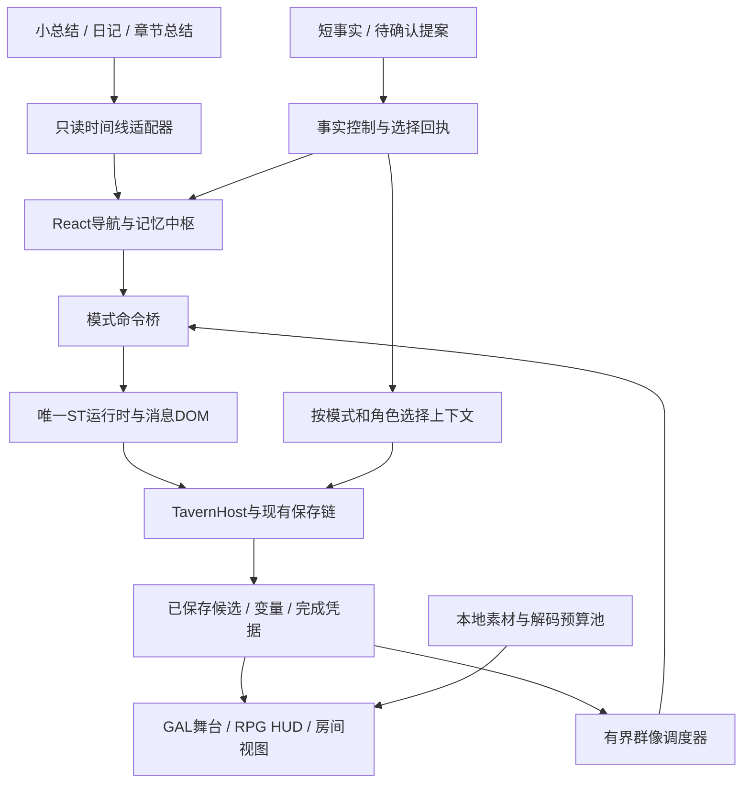

# ST Explorer：统一记忆中枢与四大原生游玩模式

> 后续仅方案：已按实际项目链接和参考原图重写为[v3原生世界方案](2026-11-07-play-world-v3.md)。用户选定沙盘优先；本历史方案不再执行，v3尚未获实施授权。

> 当前状态（2026-11-07）：用户否决本轮成果，两轮实现均已回退。本文仅保留历史讨论，不再是执行依据；此前批准和技术测试不代表游玩体验认可。见[回退记录](../../verification/2026-11-07-multimode-rollback.md)。

> 2026-11-07 执行更新：用户与Antigravity已联合批准本修订版并授权完成全部批次。Batch 1～4源码已实现，当前实现映射、验证证据、差异及平台未验项以[全批次交付](../../private/verification/2026-11-07-two-pillars.md)为准。下文保留11月6日规划快照中的拟议接口和验收目标；其“尚未实施/仅文档”描述不再代表当前状态。未打包、发布或推送。

2026-11-06 · Codex · 修订版 v2 · 交接：用户与 Antigravity（当前仓库）。

**状态：按用户最新构思完成重规划，本轮只改文档。** 旧 Batch 1 源码仍在工作区，用户已指出产品方向偏差，不能记作新方案实现或用户验收通过。先前 D1～D8 批准是历史事实；冲突的范围、默认值和批次编号由本文取代。历史见 [v1 快照](2026-11-06-multimode-transparent-memory-v1-archive.md)与[旧 Batch 1 验证](../../private/verification/2026-11-06-memory-choices.md)。

基线：`codex/playtest-20261031` / `01686330ad5e64b2ec2f90e257dabe813afbf7f1` / 0.9.8，依据包含大量未提交成果的当前工作区。旧正式包 `release/2026-11-06-startup-dark/` 不含旧 Batch 1，更不含本文重构。执行前重读 [CURRENT](../../maintenance/CURRENT.md)，保留其他改动。

配套：[Batch 1 中枢收尾](2026-11-06-batch1-memory-choices.md)定义迁移、双视图和短事实；[Batch 2～4 实施准备](2026-11-06-native-play-milestones.md)定义舞台、HUD、群像的文件、接口和验证；[技术交接](../../private/maintenance/2026-11-06-multimode-review-handoff.md)记录有效决定与接缝风险。

## 1. 两大支柱与体验目标

**统一记忆中枢是已有记忆/总结体系的可视化控制台。** 玩家在同一面板回顾剧情、查看事实与注入状态；打开面板或切视图不调用模型、不改变提示词。小总结、日记、大总结留在原仓储，不复制到记忆文件再整段发送。

**四种游玩模式是平台内置的同级入口。** 玩家无需写 HTML、CSS、正则或 MVU 补丁，即可体验标准、GAL、RPG、无限空间/AI 小镇。平台提供布局、默认样式、素材适配、模板与控制逻辑，已有作者成品仍能沿标准路径使用。基本玩法不能以“先去编写JSON路径和脚本”作为入口。

| 玩家目的 | 入口 | 默认行为 |
| --- | --- | --- |
| 看前情、找关键楼层 | 记忆 → 剧情时间线 | 当前故事/分支的小总结、楼层日记、章节总结；搜索、展开、跳楼 |
| 让角色记住硬事实 | 记忆 → 状态与事件 | 对象＋类型＋一句话事实；逐条启停，解释本轮是否使用 |
| 普通聊天与已有作品 | 标准 | 完整ST气泡流；保留故事卷宗入口 |
| 看立绘、点行动推进 | GAL | 舞台、背景、毛玻璃对话框、行动卡；无素材仍可玩 |
| 看数值与冒险结果 | RPG | 游戏HUD；建议映射已有变量，或选即用模板 |
| 跨作品角色互动、自主生活 | 无限空间/观赏 | 一个模式内的主神空间和AI小镇，共用房间与角色配置 |

取消“周期事实提取独立 Batch 4”，它归入 Batch 1 的后台总结/维护任务。群像由旧 Batch 5 改为 **Batch 4**。原文 Quick Choices 是已完成基础，不能单独视为 GAL 完成。

## 2. 当前架构映射

路径均相对仓库根；以下是已核对事实，后文“拟新增”不是现成API。

| 当前模块 | 实际能力/缺口 | 新方案复用 |
| --- | --- | --- |
| `src/pages/Roleplay.tsx`、`src/lib/roleplay/frame.ts` | 实时游玩唯一ST iframe，React管导航/恢复 | 同级模式胶囊、中枢、周边控件；不复制聊天树 |
| `src/components/chat/ChatWorkbench.tsx`、`ChatPreview.tsx`、`src/pages/StoryWorkspace.tsx` | 回顾/处理，flush与messageId跳楼 | 共用时间线与抽屉；卷宗不成为第二发送引擎 |
| `src/components/summary/MiniSummaryPanel.tsx`、`src/lib/mini-summary.ts` | extractMiniSummaries返回floor/summary；正则在st-mini-summary-regex localStorage | 共享提取设置，适配候选锚点；不把配对userText塞进事实 |
| `src/types/summary.ts`、`src/lib/summary-db.ts`、`summary-order.ts`、`diary-parser.ts` | diary/volume、bookId/branchId/source/楼层范围，rangeDetached/provenance | 联接原记录；日记日期仅展示，故事楼层负责排序 |
| `src/lib/vault/story-summary-index.ts` | 故事目录轻量元数据，**不是剧情总结库** | 保持目录性能用途 |
| `src/components/roleplay/MemoryPanel.tsx`、`MemoryCaptureSheet.tsx` | 卡片控制已做；抽屉整楼预填 | 改双视图和短事实抽屉 |
| `src/lib/roleplay/memory-capture.ts` | body取message.content.slice(0,64000) | 改来源锚点＋可选小总结建议；输入初始为空 |
| `src/lib/roleplay/memory.ts`、`memory-selection.ts` | Markdown真源、schema2/journal、手改保护、来源；按重要性/时间选长正文，默认1200token | 事实合同、提案区、迁移、按需低预算选择 |
| `agent-runtime.ts`、`tool-agent.ts`、`context-ledger.ts`（roleplay目录） | 原生/柏宝书互斥，旧supplement失效基础 | 维护者适配；索引/检索/最终装配统一资格过滤 |
| `src/lib/summary-engine.ts`、`summary-templates.ts` | 总结生成、模板和参数快照 | 可选增量事实侧段；不开启时原输出不变 |
| `src/lib/roleplay/tavern-host.ts`、`story-session.ts`、`runtime-store.ts`、`paths.ts` | provider/保存/Vault/IDB；groups仍为空 | 模式命令/房间适配；群聊需真正补路由 |
| `src/tavern/play-controls.js/.css`、`src/lib/roleplay/choices.ts`、`turn-settlement.ts` | 原文选项、幂等派发、候选/变量凭据 | 共用发送；凭据扩actor/run，不代表未知插件完成 |
| `src/components/VariableInspector.tsx`、`src/lib/variable-inspector.ts`、`frontend-workbench.ts` | JSON Pointer/差异/指定候选变量；预览非真实MVU | 共用快照；Inspector仅在调整/诊断里 |
| `src/components/roleplay/ChatProcessPanel.tsx`、`src/lib/roleplay/process-log.ts` | 有限诊断日志，非事务依据 | 解释使用记录、预算和策略 |
| `src/lib/portrait-store.ts`、`character-portrait-cache.ts`、`portrait-preview-cache.ts` | 本地图片；16MB字符串/32MB文件缓存 | 补解码预算协调，现有缓存不保证解码内存 |
| `src/lib/roleplay/branch-inheritance.ts`、`story-package.ts` | 分支继承、分享过滤 | 事实/私密/房间/素材的明确继承与导出 |
| `src/tavern/host-bootstrap.js`、`scripts/tavern/host-overlay.mjs` | 固定ST集成接缝 | 注册模式桥，不直接改上游包或生成文件 |

InfiPlot、OpenStory、AI修仙模拟器为体验参考，本轮未核验其源码或许可，也不依赖其服务。遵循[扩展兼容](../../principles/extension-compatibility.md)和[ST导入边界](../../principles/sillytavern-import.md)。

## 3. 总体架构与状态机



### 3.1 一个运行时、四种原生模式

`PlayMode = standard | gal | rpg | ensemble`，`ensembleForm = sanctuary | town`。与运行配置classic/agent、memoryOwner分开。旧observer仅为历史名；若确有持久配置则迁至ensemble/town，没有则不制造迁移数据。

平台内置ST布局适配器＋React周边控件。GAL仍使用原消息节点，不复制innerHTML、重执行脚本或创建第二助手iframe。历史回看仍是原ST列表；不能粗暴隐藏虚拟列表测量根或搬走执行中的节点。先验证固定上游容器接缝，必要时增加窄导出。标准为兼容基准；作者成品依赖旧DOM时，可单独关闭舞台包装/回标准，不静默丢HTML、按钮或脚本。

拟新增`play-mode.ts`、`play-bridge.ts`、`src/tavern/play-mode-bridge.js`与作用域CSS，复用host注册，不引入RPC框架、重型状态库或第二消息数据库。

```ts
// 设计合同，尚未实现。命令scope沿用现有vault/host/branch/selection守卫。
interface ModeState {
  requested: PlayMode; applied: PlayMode;
  switchState: 'ready' | 'waiting-turn' | 'applying' | 'failed';
  ensembleForm: 'sanctuary' | 'town';
}
interface PlayCommandContext {
  storyId: string; branchId: string | null;
  hostInstanceId: string; vaultEpoch: number; selectionEpoch: number;
  operationId: string;
}
// setMode只改呈现；sendChoice/stepActor/queueEvent分别受提交、来源与预算守卫。
// snapshot仅传有界派生状态，不传全聊天/全图片/全角色私密数据。
```

### 3.2 状态与切换

| 状态轴 | 合同 |
| --- | --- |
| 聊天 | idle→preparing→generating→settling→idle；save-failed阻止后续派发 |
| 展示 | 空闲切换不发模型、不重建iframe；生成中记录requested，正式保存边界应用；失败保留旧模式/草稿 |
| 中枢 | timeline/facts同级，各自记搜索、展开、滚动；与模式无依赖 |
| 提案 | queued/running/pending-review/accepted/rejected/stale；切模式不触发任务 |
| 群像 | idle/running/pause-requested/paused/stopping/completed/failed/interrupted；重开不续跑 |
| 导航 | 沿原active/parked/switching/closing；离开群像停排新步，收尾/停止当前步后释放资源 |

切候选、编辑旧楼、切分支/库，使绑定来源的选项、提案和delta失效，迟到响应不能写新scope。切模式保留草稿、候选、阅读锚点、助手状态和变量。普通阅读位置变化不影响剧情凭据。React用有界稳定snapshot订阅，拆卸解绑listener、释放URL。

### 3.3 顶栏与390px

最终四模式同级胶囊；桌面图标＋短名，390px四个44×44图标，选中态、aria-label和长按说明清楚。390px左右8px内边距内：返回44＋模式176＋记忆44＋更多44＋间隙24＝332px，余42px；过程/分支/脚本放更多，标题放内容区，不能加第二行按钮。分批未完成的模式不做可点击空壳。

中枢桌面为可收起侧栏，手机为单张Sheet；顶部两个Tab始终同级。Switch外层、关闭、主操作≥44×44；状态含文字/图标，不只靠颜色。保存失败留草稿；返回/Escape/焦点恢复/读屏纳入验收。沿四主题，动画遵守reduced-motion。

## 4. 支柱一：统一记忆中枢

### 4.1 剧情时间线

直接整合当前采用候选的正则小总结、SummaryItem(kind=diary)日记、SummaryItem(kind=volume)章节/分卷总结。同story/branch过滤，不按角色名合并所有故事；rangeDetached记录放“未关联楼层”，不猜跳转位置。DIY不默认混入，原工具入口保留。

按楼层起点/终点、来源种类、稳定ID排序；章节可折叠并示覆盖区间，日记可按角色筛选。重叠资料保留来源标签，不合并成一条“真相”。小总结的floor在投影时转换为messageId/candidateId/digest；旧总结只有范围时标“范围关联”，不伪造候选验证。日记内部故事日期仅作标签，不改变楼层顺序。

搜索三类内容；跳楼前核对身份，陈旧/分离来源显示原因及原记录入口。编辑跳原总结/日记编辑页，保存后刷新投影。打开/切视图不增加Prompt，不把世界书或旧档案全量搬进事实仓。

缓存键含story/branch/session revision/record revision/regex digest；候选、源编辑、关联变动、切库使缓存失效。首屏≤40项，长正文按需展开，搜索分段可取消。现extractMiniSummaries扫描全会话，实施要增量或分段，不能每个流式token扫描数千楼。正则设置与原面板共享；复杂自定义正则需可终止worker/限额，不能靠无法打断同步RegExp的计时器防卡死。

### 4.2 状态与事件表：结构化事实、便签流展示

卡片展示类型、对象、短句、来源、可见对象、Switch和本轮使用原因，展开编辑/删除恢复。类型至少承诺、状态、事件、秘密、约定。subject是描述对象，audience是谁可以知道，不能混用。

例：`[事件][艾莉丝] 玩家曾赠送艾莉丝一条银项链。` 秘密如“艾莉丝是失踪王族继承人”仅指定actor可见，不因对象是艾莉丝自动公开。

```ts
// 拟扩现有Markdown frontmatter，body仍是唯一事实正文。
interface FactFields {
  schema: 3; kind: 'fact';
  category: 'promise' | 'state' | 'event' | 'secret' | 'agreement';
  subject: { actorId?: string; label: string };
  audience: { kind: 'shared' } | { kind: 'actors'; actorIds: string[] };
  approval: 'confirmed';
  supersedes?: string;
}
// 复用path/body/revision/digest/sourceRefs/enabled/deletedAt。
// 提案在独立控制文件；不能把待确认内容伪装成普通disabled记忆。
```

建议20～80个可见字符，硬上限160个Unicode码点，一条一个事实；字符上限与token预算分别检查。对象可手填/选角色，普通保存不要求标题、UUID、路径或权重。内容作为资料，不执行宏/HTML/工具/脚本/slash。秘密默认角色私有；未绑定actor时要求明确选择，不能退为shared。

持久状态：待确认/已启用/已停用/已失效/已删除；使用状态：本轮已用/未匹配/超预算/角色不可见/当前维护者接管。enabled不等于已注入。来源变化失效、恢复默认停用、用户手改不被后台覆盖。

### 4.3 短事实抽屉

楼层菜单“记住一件事”（兼容原入口名）→轻抽屉：类型、对象、一句话输入、“保存事实”主按钮。来源为折叠楼层链接，默认事件与当前角色；输入为空，不预填原文，不把提示示例当数据。

有小总结时显示“引用本楼小总结”，只读已有结果、不调AI。短且单一的总结可填入后保存；长/多事实总结作参考供选择提炼，不能静默截断成失真事实。无总结走手写或原总结工具。保存归视图二；长文收录仍去原“总结/日记”入口。

### 4.4 周期提取回归后台Prompt任务

默认关闭；开启后按正式保存的assistant回合计数，建议每5回合，可设3～20。候选重选、重复保存不重复计数。优先随已有总结/原生维护任务输出版本化事实侧段；没有可复用任务才排一次受预算控制的小调用，不每轮重发整部故事。柏宝书接管时不同时启原生定时器；只读概览/原编辑入口由适配器接入，不猜写插件内部格式。

输入仅当前actor可见的新增范围或该范围已有总结＋必要事实指纹；输出最多6条，建议1024输入/384输出token上限。本地验证JSON schema/显式列表、长度、来源和重复，错误/不完整输出拒绝，不无限修复重试。逐条编辑、接受、拒绝；**撤销旧D6自动接受推荐，自动产物全部待确认**。候选队列默认上限50条，满则暂停，不淘汰未看内容。

任务ID绑定scope/sourceRefs/输入digest/策略版本；源变化产物stale。计数、水位和拒绝指纹可恢复，网络请求不自动重放；删除/拒绝项不可下一轮自动复活。既有事实变化显示替代建议，确认后原子停用旧项并记supersedes，不能按更新时间默默覆盖承诺/状态。

### 4.5 维护者、按需注入与解释

Timeline始终不因展示而注入；确认事实是一类可控输入。标准聊天显式开启事实使用，切模式/视图不重配classic/agent或memoryOwner。窄`MemorySourceAdapter`提供read/subscribe/capabilities/openOriginal；原生事实可控制，柏宝书等无稳定写接口时只读并跳原面板，不假装可逐项修改所有插件。

统一筛选：story/branch→approval/schema→删除/启停/有效性→actor audience→相关性→预算。相关性按参与者、地点/对象、用户固定项、关键词确定，不调AI分类；宁少用并解释。序列化为`[类型|对象] 短句`，不附整楼/UUID/冗余JSON。

建议本轮STE事实总预算384token、硬上限768、≤8条，**各事实入口共享额度**。原生Agent已读同项不再另加classic补充。原文件记忆/插件总结保持各自系统行为，Console显示归属；不把任意旧文件认成短事实。自己控制的记录/事实按ID/digest去重；第三方世界书无明确来源关系时不靠模糊相似度擅删内容。

正文、启停、来源、audience、维护者变化使policyDigest失效，覆盖Ledger、索引/search/read、最终装配和待发送快照；发送前重验。已发请求无法撤回，提示下次生效；本轮选择回执在过程面板可看。

### 4.6 旧Batch 1迁移

保留journal/SourceRef/手改保护/删除恢复/幂等和原文选项；替换全文预填、长文默认候选注入、单列表定位。

旧schema2的`entries/*.md`无结构化事实语义，不能仅按长度当确认事实，也不截160字继续发。可恢复迁移标为`legacy-excerpt`，退出新事实注入，原enabled/full body作历史保留；面板“旧摘录待整理”可手动提炼或显式收录为总结。非entries旧Agent文件按原系统展示，不全库停用。首开说明旧摘录已暂停；迁移未完成的读取策略也应拒绝把它们当新确认事实。

迁移有version/journal/expectedDigest及vault/branch守卫，中断幂等，分支与旧journal不能复活旧注入；提炼确认才新建事实，保留来源。旧二进制不懂新合同，回退用升级前副本，不承诺同库来回运行仍隔离。

分享包省略待确认/删除/失效/私密及含旧正文控制历史，重建派生索引；完整备份沿原机制。已公开故事正文不会因停用事实被抹除。具体实施见Batch 1。

## 5. 支柱二：四种原生玩法

### 5.1 标准

ST气泡流、候选、故事卷宗、输入、扩展及成品HTML保留。关闭新能力时Prompt沿原路径；不强迫换预设、世界书或新建库。

### 5.2 GAL

内置背景、角色立绘、渐变遮罩和半透明毛玻璃对话框（等效backdrop-blur-md），文本底色使亮背景/无blur时仍达正文4.5:1对比度。情绪/地点用可选变量/显式标签映射，不每token调情绪识别。默认中性立绘，无图为深色CSS舞台；选素材即可，不需写脚本。

行动卡2～4项、数字角标、金边微光、轻按压，点击同步锁全组；共用literal派发/草稿追加/operationId/候选守卫。“缺选项时补齐”默认关，成功结算后每候选最多一次，建议1024输入/192输出token；输入只取可见末段剧情/小总结和必要短事实。失败保留原输入，过期丢弃、不循环重试。

390px选项纵排贴近底部输入；键盘弹起先收窄/隐藏立绘，dialog/choices内部滚动，输入/提交在visualViewport和safe-area内。可读文字不等图片或补选项请求。

### 5.3 RPG：默认模板能直接体验

图形HUD：渐变生命/灵力条、境界/等级/好感徽章、背包格、任务列表。已有MVU数据自动建议模板并确认；不规则数据用可视选择器绑定；空白故事选“通用冒险/修仙”内置模板，在新分支工作副本初始化必要schema/提示词片段，沿原MVU链更新。不能覆盖旧变量或偷偷安装扩展；能力缺失提供准备入口，不展示假数据称为可玩。

绑定用JSON Pointer，缺值“未记录”，无效上限不画假比例；显示真实值，进度钳到0～100%。当前已保存候选是真源；临时预览标结算中，TurnReceipt后产生最终delta。切候选/分支/重开仅换快照，不播放奖励；同提交最多一次delta，600～900ms上浮淡出、同指标合并、并发≤4。

判定带依据结构化数据/明确标签/内置模板协议，把系统掷骰与文学正文分开；不能从任意数字猜判定并删正文。HUD不另建战斗引擎，读MVU，写入仍走原链。Inspector在高级调整/诊断，不是玩家主界面。

### 5.4 无限空间/AI小镇

主神空间：选择已认识角色卡，创建独立房间故事，明确选来源故事/分支及带入哪些已确认关系/事实。默认身份＋玩家选中关系快照，不自动带整段旧剧情、私密日记、全部变量/世界书。房间对话只写房间，不回写源故事/卡片；可指定角色手动互动。

AI小镇：同一房间/关系，稳定轮询＋回复概率，单步或3～5轮。提供地点/活动摘要与说话者列表；首版不做3D/寻路/持续后台世界。身份、私密记忆和活动由保存回合推进。

用ArchiveStory/StorySession＋分支RoomConfig，不建第二消息库；story.characterId是归档归属，actorId是房间实例，不能等同。同卡不同经历须明确区分或阻止重复。来源snapshot记录版本，更新由玩家选择，源故事变化不悄悄改变房间。

上帝干预为悬浮胶囊，点击展开、提交成功收起、失败留草稿。事件是可见旁白楼，literal文本，以FIFO在当前回合结算后/下actor准备前保存一次，不伪装system最高权限。未应用可取消，已应用编辑/分叉。主神空间也可用。

必须补固定ST的指定actor单步、group/chat路由与身份保存；关闭ST automode，只有一个调度器。单步/隔离未通过，不开放自动run。

## 6. 素材体量与解码内存

### 6.1 背景库与外部素材

随包10～15张通用静态WebP，建议12张，单张≤150,000字节，素材＋manifest硬上限2,000,000字节；此额度不冒充整个功能JS增量。覆盖城镇/室内/森林/山野/夜景/休息室等。manifest含尺寸、hash、来源与许可，自动验张数/单图/总量，人工验压缩质量；合法素材未齐不能算完成。

支持选外部目录、卡片声明背景、既有立绘库。优先级：分支显式选择→卡片背景→内置→CSS渐变。外部目录只读，通过既有Tauri/Capacitor能力；Web用文件选择/可用目录句柄降级。绝对路径不写聊天/发模型；缺素材回退、不阻塞。分享自定义素材须显式附带并检大小/许可，不能自动打包外部目录。

### 6.2 LRU与生命周期

移动32MiB、桌面64MiB统一舞台媒体预算，含当前显示、过渡中和LRU保留的**解码像素估算**，不是仅压缩字节。RGBA按width×height×4核算，保守留纹理/双图过渡空间；预留不足先释放或降采样，不以“引用中”无限越限。

只加载当前背景/表情，最多预取下一张，并发解码≤2；手机通常显示1～2角色，其余轻头像。读尺寸→目标缩放→预约→解码→显示；拒超尺寸/动画炸弹。外部巨图需有界解码/原生缩略图路径，不能先完整decode再验预算；WebView/Android能否保证此点是Batch 2门槛，不支持时限制像素并引导压缩副本。

LRU key含vault epoch/assetId/revision/尺寸/变体；release、清img引用、revokeObjectURL、ImageBitmap.close、取消在途任务；后台/关闭host清理。协调现有字符串、文件和解码池，不重复缓存同图多份。卡片JSON可能本就内含全部Base64，至少不全量转Blob/解码，不structuredClone全组差分；通过素材元信息清单按条读取。

32/64MiB是应用可核算媒体池，不是WebView总进程内存承诺。验原生峰值和反复切换后回落；blur限对话框局部，移动减半径/动效，避免全屏持续滤镜。

## 7. 上下文按需剪裁与隔离

| 模式 | 保留 | 可省略 | 边界 |
| --- | --- | --- | --- |
| 标准 | 原卡/预设/世界书/扩展 | 新模式装饰信息 | 新能力关时原Prompt不变 |
| GAL | 剧情、说话者、必要关系、活动MVU/SPreset必需块 | STE新增背包明细/无关数值重复说明 | 精简不能破坏更新协议；不保证任意长预设首字速度 |
| RPG | MVU schema/必要变量/更新协议/工具结果/战斗事实 | 重复叙事状态/无关回顾 | HUD显示子集不等于模型更新所需变量集 |
| 群像 | 当前actor人格/私密、公共事件及获授权资料 | 其他actor私密卡片/记忆/日记/世界书 | 全链路隔离，不只过滤UI |

拟新增context-policy：片段标来源、owner、audience、required、estimatedTokens；先资格后预算，Manifest给过程面板。仅自动裁STE拥有且声明可省略的块；未知作者预设/插件混合文本默认保持，明确优化策略由玩家选择，不事后用正则删“看起来数值多”的内容。GAL保守兼容时不宣称已达精简目标。

群像不能以保守兼容为由混入不明私密块：卡片公共简介由玩家确认，不默认全卡公开；A的provider/tool/quiet拿A只读视图，不能检索全角色索引。Ledger/选项/提案缓存键含story/branch/actor/audiencePolicyDigest，换身份丢迟到工具结果；私有独白不写共享历史。

ST group若合并全卡必须关闭并逐actor装配；世界书也按公开/私有绑定。共享历史已公开的秘密不能后来收回。任意插件共享JS环境不是安全沙箱；无法约束全卡读取/旁路外网时，阻止该组合开启隔离群像，给用户选择兼容组合。普通标准模式保持可用。

## 8. 结算与Token熔断

主回复、quiet/helper、tool-agent、SPreset后续、选项、事实任务都经过同一预算入口；仅限最终回答长度不算总预算。TurnReceipt读正式保存候选及正文/变量摘要，等待已知助手/MVU/柏宝书flush；ProcessLog、HTTP结束不能单独放行。未知完成、保存失败或缺计量时保守暂停。

| 默认值（实施前可按实测调小） | 规则 |
| --- | --- |
| actor | 默认2～4，首版最多4活跃 |
| 一轮 | 扫描角色各至多一次，默认最多2回复；每轮起始游标轮转保公平 |
| run | 默认3轮，硬上限5轮/10回复；每人每轮只抽一次概率，全跳过即暂停 |
| 并发 | 主1，辅助队列1；run中默认不补选项，事实可等run后复用总结 |
| 总量 | 最多16个网络调用；累计输入＋最大输出预约≤64,000估算token；单回复输出≤768 |
| 时间/错误 | 单步120秒、run10分钟；保存/隔离/预算/扩展异常即暂停，不自动网络重试 |
| 选项 | 每结算候选≤1次，1024输入/192输出，15秒 |
| 事实侧任务 | 每周期≤1次，1024输入/384输出，30秒；复用任务计原调用总额 |

请求前预约input estimate＋max_output，结束以usage结算；无usage/取消/失败不能记零消耗，保留保守占用到run结束。每次调用验证scope/runId/步数/调用数/token/deadline。provider无计量/停止能力或脚本旁路不可纳管时，不开放“严格熔断”自动run。价格未知不虚构费用，估算和实耗区分。

示例：10×(3000输入＋768输出)=37,680token，加一次事实任务上限1408为39,088，尚不含工具后续。若每步输入8000，64,000上限会在第8步前停止；5轮是上限，不保证一定完成。第一步预算不足说明原因与可减少项，不偷偷裁必需协议。

暂停为当前回合后不排下一步；立即停止abort主/辅助请求，部分正文沿原草稿机制。operationId同正式消息保存，重开读回执、不重发已派发消息；事件也遵此规则。

## 9. 批次与成本

| 批次 | 可独立体验结果 | 依赖 | 粗估投入* |
| --- | --- | --- | --- |
| **Batch 1收尾** | 双视图、短事实、旧摘录整理、后台待确认提取；保留选项 | 原记录/记忆/分支/注入失效 | 6～10工程日 |
| **Batch 2** | GAL舞台、约12张背景、媒体池、可选补选项 | 事实合同、单ST布局接缝 | 7～11工程日 |
| **Batch 3** | 即用RPG模板、绑定、HUD/delta/判定带 | 模式壳、候选变量/MVU完成 | 6～10工程日 |
| **Batch 4** | 主神空间召入与单步；再交AI小镇有限推演 | 群聊身份、跨故事选择、隔离/预算 | 12～20工程日 |

*31～51工程日仅比较范围，非日期承诺；实际受ST接缝、插件隔离、素材许可与解码能力影响。小批独立验证，具体文件/接口/命令/退出条件在配套计划。

验收分别记录：实现、自动测试、桌面/390px浏览器、Windows WebView2、Android真机/真实键盘、用户视觉体验、打包发布。短视口不冒充软键盘，旧批次测试不充当新版通过。

风险：旧楼层范围不可信→标关联级别；迁移→保全文/日志、不复活；未知插件→标准兼容、群像门控；媒体→预约与原生峰值；Token→单账本与必需块；跨作品关系→玩家选择来源/事实。不上新向量库、云端黑盒、重型游戏引擎。

## 10. 修订状态

- [x] 双视图定位、短事实与引用小总结、旧摘录处置写明。
- [x] 四模式同级；周期提取回Batch 1，主神空间/小镇为Batch 4。
- [x] 背景10～15张/150KB/约2MB、解码32～64MiB、按模式剪裁及私密隔离量化。
- [x] 保留单ST/TurnReceipt/Ledger/预算/UI硬约束，并修正适用范围。
- [ ] 新架构代码、素材与产品验证未执行；不得把旧Batch 1勾选状态继承为新版完成。

Antigravity重点复核：时间线关联真实性、旧摘录退出全部新事实注入路径、无需手写代码的RPG模板、保留消息节点的GAL、解码峰值、指定actor与私密世界书/tool/quiet隔离。接缝不支持时改具体方案，不用虚构API开工。

