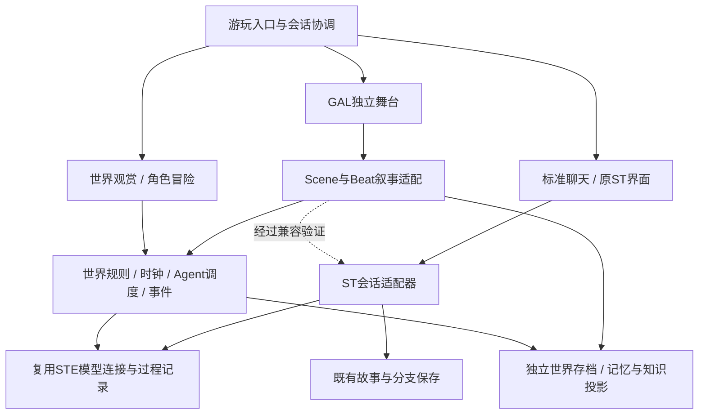

# STE 原生游玩重规划 v3：先做可推演的世界

2026-11-07 · Codex · **v3 已正式批准，Batch 0＋1 底座已确认；用户随后授权 Batch 2～5 连续源码实施、统一实测。** 后续四批源码已接通，技术检查与用户可玩性认可分开记录。当前交付见[统一验证报告](../../verification/2026-11-07-play-world-b25.md)，实际接口与文件见[执行记录](../../maintenance/2026-11-07-play-world-b25-execution.md)。Android 真机及用户体验仍待统一实测，未打新安装包。此前两轮否决实现仍封存，不恢复旧代码。

阅读顺序：[交互样稿](2026-11-07-play-world-concept.html) → 本文 → [分批实施与验收](2026-11-07-play-world-batches.md) → [参考项目核验](2026-11-07-play-world-references.md)。样稿是原创示意地图和固定事件演示，不调用模型，不连接 STE，不是产品实现。

## 1. 目标从“聊天模式按钮”改为“真正的游玩过程”

玩家打开一个世界，看见角色在地图上行动。角色有自己的需求、目标、可达地点和所知信息；行动会消耗时间和资源，产生遭遇、合作或冲突。玩家能观察、追踪人物、施加事件、接管一个角色，也能存档后重选。剧情来自这些后果，而不只是另一轮聊天文本。

原图 `2.STE参考.png` 的核心是地图、人物位置、世界时钟、宏观控制和事件记录的联动。血条、卡片、毛玻璃只是表现细节。此前方案的根本错误，是先规定复用酒馆聊天 DOM，再把玩法压缩到这个容器中；完成了局部操作，却没有世界模型和游戏循环。新方案不再以“原聊天节点保持不变”作为游戏前端的约束。

第一段可游玩的目标：打开内置世界，30 秒内能选中角色、看懂其去向与原因；推进数步后出现资源竞争或互助；在同一存档降雨封路，看到角色改道或改计划；退出重开能继续；无需配置 JSON、MVU 路径、正则和 HTML。30 秒指本地交互目标，不承诺远程模型响应时延。

### 四个同级入口，三个明确的运行边界

| 玩家入口 | 主体画面与核心操作 | 运行方式 |
| --- | --- | --- |
| 标准聊天 | 原有酒馆、故事卷宗、完整作者前端及扩展 | 现有 ST 兼容运行时，继续保留 |
| 世界观赏 | 大地图、人物轨迹、事件、追踪、世界干预 | 原生世界规则与 Agent 调度，不加载酒馆聊天界面 |
| 角色冒险 | 同一世界中接管一个角色；探索、交涉、装备和任务 | 与世界观赏共用世界状态，改变控制权和信息视角 |
| GAL 剧场 | 全屏场景、角色、分镜对白、结构化行动分支 | 独立 Scene/Beat 叙事会话；可接原生剧情或经验证的 ST 适配器 |

“主神空间/AI 小镇”是世界引擎的场景包：休息室、小镇、荒野等，不再用传统群聊冒充空间模拟。修仙也是规则包，不能把整个引擎硬编码成一种题材。

同级入口不等于任意存档可以无损互转。世界观赏↔角色冒险切换同一 WorldSession；世界事件↔GAL 表现可建立受控桥接；原 ST 聊天进入一个新世界需要创建派生世界，保留来源分支。没有空间、规则和人物数据的旧故事，不假装按一个按钮就能变成完整沙盘。

## 2. 实际参考与采用范围

核验了笔记原文、原图及五个项目当前固定提交中的 41 个文件；未运行这些项目，不把 README 描述当作实测。详细路径与纠偏见[核验表](2026-11-07-play-world-references.md)。

| 参考 | 本次借鉴 | 不直接承接的前提 |
| --- | --- | --- |
| cultivation-world-simulator | 地图为主体；状态→合法行动→规则结算→事件→叙事；世界时钟 | 其 Python/Vue/Pixi 系统和全部修仙规则不整体搬入 STE；当前许可证为 CC BY-NC-SA 4.0，代码/素材不直接复制 |
| OpenStory / WorldKernel | 感知、计划、行动、反思；地点与访问权限；自由观赏/剧情控制 | 其 Redis、Python、Agent-Kernel 分布式部署不是 STE 必需依赖；地图动画不等于模拟寻路 |
| InfiPlot | 独立 PlayCanvas、Scene/Beat/Choice、历史与存档 | 生图/视觉/TTS、多角色创作流水线与分支预生成会增成本，不设为默认；源码并非只靠分层立绘 |
| PawzoChat | 人物独立记忆、群聊调度限制、生活动态 | 当前已读 UI 确认了记忆编辑删除，未确认逐条启停；逐条开关是 STE 设计要求，不能冒称照搬现成能力 |
| AIcove | 自然的客户端导航、主体内容优先、移动端细节 | 已识别项目名与 Flutter 技术栈；未找到仓库级许可证，仅借鉴交互，不移植框架或源码 |

新机制用 TypeScript 自行实现。参考项目代码仅用于分析；需要移植具体实现或素材时另行明确文件来源和许可。本次不把不明许可或非商业素材打入程序。

## 3. 前端布局与用户流程

### 世界观赏：地图必须成为主体

桌面 1440×900：顶部约 56px 世界栏，显示世界名、时间、运行/暂停；主区地图约 70%～76%，右侧 300～340px 事件流；人物追踪卡浮在地图一角，按需展开。底部是播放、单步、速度及轻量干预胶囊。事件点击后定位人物/地点并显示前因后果；点地图人物显示“正在做什么、为什么、下一步”。规则、榜单、关系和秘境在专属面板中打开，不常驻铺满按钮。

视觉采用原创像素地形或统一地图画风，深墨色 UI、暖纸色标签、按危险/关系语义着色。第一版美术必须完整覆盖地形、路径、地标、人物标记、选中与事件焦点，不把灰盒地图列为美术完成。用户参考图用于构图与玩法对照，不复制其地形纹理和角色美术。

四个玩法入口采用同一行图标胶囊分段控件，不另铺第二行模式按钮。桌面可带短标签；390px保留4个44px图标位，世界名移到地图角落，时间/运行状态就近呈现。切换会话若要保存、派生或无法兼容，解释具体原因，不能把图标当成无条件换皮。

390×844：地图保持全宽主体，顶部容纳返回、模式胶囊与菜单；底部44～48px控制。事件为可拖拽的底部面板，默认展示最近1～2条，可展开为事件页；选人物时替换同一面板，避免叠三层抽屉。双指缩放、单指拖图，人物命中框至少44px；密集角色合并为人数标记，点开选择，不能让头像相互遮挡到无法操作。

干预栏平时为44px胶囊。预设“暴雨/道路封闭/资源发现”一触发即进入可撤销队列，下一模拟步生效；自然语言先显示解释结果，例如“灵泽暴雨2步；渡口禁行；林地采集效率下降”，由玩家确认后应用。仅有文学线索而无规则效果的输入必须标“剧情线索”，不能谎称已经改变天气或数值。

软键盘弹出时暂停镜头跟随，输入面板绑定可见视口；地图可缩小，确认/取消始终可见。后台自动暂停，返回先展示已保存进度，不继续悄悄花费模型额度。

### 世界创建：轻量向导，默认就能玩

1. 选内置“山海试炼”世界：地图、区域、资源、规则和12个原创角色已齐备，默认无需导入任何卡片。
2. 可替换其中角色：从角色库选择，展示公开身份与建议的世界身份；调整一个性格/目标标签即可进入，高级映射折叠。
3. 选择观赏或接管角色、模型连接与预算档，确认创建独立存档。未配置模型可玩本地规则演示，清楚标注“规则驱动”，不伪称 AI 行为。

跨作品角色必须有适配：来源卡只提供人设和已选关系记忆，生命、战力、位置等按当前世界规则赋值。角色卡中“无敌”“全知”等自然语言不是绕过世界规则的权限。世界书的地点、组织、法则提取只是待确认提案，不能自动当作合法地图和可执行代码。

### 角色冒险、GAL 与休息室

- 角色冒险：接管暂停在步边界，显示本人可见地图、可执行行动和装备；NPC继续模拟。战斗、消耗和掉落由规则结算，叙事不覆写结果；难度、死亡/受伤规则在开局说明。放回自动时恢复目标驱动。没有把作者MVU JSON变成地图的万能适配器。
- GAL：Scene含地点/时间/素材，Beat含说话者/旁白/对白，Choice含选择ID与动作意图；一次场景请求可以返回多段Beat。点击继续读下一句不调用模型；走分支才生成。立绘和背景可本地选用，缺图有完整审美回退。2～4项选择与自由行动并存，点击立即锁定，打字机可跳过；历史为独立日志，不呈现酒馆气泡。
- 休息室/小镇：同一位置与日程机制，角色前往书房、院落、餐厅并发生可解释互动；原故事带来的关系是注明来源的事实，不把整篇聊天扔入每个人的提示词。生活动态从真实已发生事件派生，手动查看即可；首版不做微信/QQ、后台通知或自动生图。

## 4. 架构：原生世界引擎＋明确的酒馆兼容通道

### 对“酒馆全部无头化”的技术判断

STE当前`Roleplay.tsx`把`tavern.html`放入iframe；`frame.ts`注册宿主；`host-bootstrap.js`桥接API、保存和扩展。上游`script.js`在模块初始化就绑定`#chat`，`GenerateInternal`读取`#send_textarea`，流式处理绑定消息DOM，原版助手和作者脚本还可能依赖iframe、事件顺序及元素尺寸。把iframe设为不可见不等于无头化；删除DOM也不会自动保留这些扩展行为。

因此接受“玩家看到独立游戏界面”的产品方向，**不承诺一步把任意ST扩展变成无DOM引擎**。推荐的实施结构：



| 路径 | 建议 | 原因与边界 |
| --- | --- | --- |
| 将游戏套在ST DOM上 | 放弃 | 重复旧失败，仍以消息为世界实体，难建立空间和规则 |
| 一次性抽净ST为全兼容无头库 | 不作为首批前提 | 需剥离初始化、宏、世界书、生成、渲染、扩展生命周期，风险远高于一个前端重写 |
| 原生WorldCore＋复用STE服务；ST保留标准通道 | **采用** | 沙盘不受DOM限制，原聊天兼容不退化；角色/资产/模型服务共享 |
| GAL通过隔离ST兼容运行时生成 | 技术验证后选用 | 前台独立舞台，后台可能仍需DOM宿主；必须诚实称兼容宿主而非纯无头 |

不同时为12个NPC创建12个酒馆iframe。WorldCore只运行一份世界，模型请求按角色可见投影构建。原生引擎也不另起Redis、Python服务或第二套模型配置。

### 当前模块复用与新增边界

| 当前文件/目录 | 用法 | 需要新增或谨慎改造 |
| --- | --- | --- |
| `src/pages/ChatHub.tsx`、`src/App.tsx` | 保留聊天入口；增加原生游玩入口/路由 | 新`PlayHub`、`WorldPlay`、`GalPlay`，实际路由以实施时核对为准 |
| `src/components/roleplay/RoleplayWorkspace.tsx` | 现有单会话、切库epoch、后台保留机制 | 新会话协调器接管写者租约；不能在它仍挂旧ST时启动第二个写者 |
| `src/lib/roleplay/provider.ts`、连接配置 | 复用prepare/send及Tauri传输 | `ModelGateway`预算/取消/角色可见上下文；禁止把密钥送入Worker |
| `catalog.ts`、`assets.ts`、角色/世界书仓储 | 只读选择卡片、素材及来源关系 | `WorldImporter`生成角色实例和声明式世界提案，保留原卡 |
| `story-session.ts`、`runtime-store.ts`、`memory.ts` | 借鉴分支、来源校验和恢复journal | 原存储绑定storyId且有路径白名单，**不直接复用它伪装worldId**；新增WorldRepo |
| `src/lib/vault/`、`repo/`、`idb.ts` | 复用Vault/IDB后端及epoch约束 | 新集合、目录、索引、备份与导入检查，不能只写localStorage |
| `ChatProcessPanel.tsx`、`process-log.ts`、`request-diagnostics.ts` | 复用请求/用量/失败诊断语义 | 新session/tick/actor字段适配；不强塞世界事件为聊天楼层 |
| `VariableInspector.tsx`、`frontend-workbench.ts` | 保留ST/MVU调试能力；供开发者核查 | 世界硬规则状态不是从MVU反向猜；新世界实体检查器按需开发 |
| `MiniSummaryPanel.tsx`、`summary-engine.ts`、`summary-order.ts`、`record-capture.ts` | 既有小总结/日记/章节摘要来源 | 通过只读Adapter聚合时间线，不复制整楼 |
| `src/tavern/`、固定`vendor/tauritavern` | 继续维护标准聊天和已验证扩展 | GAL兼容试验单独进行；世界首批不改ST DOM |

## 5. 世界的真实状态与运行循环

### 状态模型

```ts
type SessionKind = 'st-chat' | 'world' | 'gal';
type SessionRef = { kind: SessionKind; id: string; branchId: string };
interface WorldSnapshot {
  schemaVersion: 1; worldId: string; branchId: string; revision: number;
  tick: number; rulesetId: string; rulesetVersion: string;
  seed: string; rngState: unknown; mapRevision: string;
  actors: Record<string, ActorState>; regions: Record<string, RegionState>;
  resources: Record<string, ResourceState>; relations: RelationState[];
  scheduledEvents: ScheduledEvent[];
}
interface ActionIntent {
  actorId: string; action: string; targetId?: string;
  expectedWorldRevision: number; source: 'player' | 'planner' | 'rule';
}
interface WorldEvent {
  id: string; tick: number; kind: string; actors: string[]; regionId?: string;
  causeIds: string[]; visibility: 'public' | { actors: string[] };
  effects: ValidatedEffect[]; // 由规则引擎生成，模型不能直接写入
}
```

以上为拟议接口，不是已有类型。Actor包含位置/移动进度、生命或体力、背包、稳定倾向、当前目标、日程和动作持续时间。PrivateProfile与Knowledge单独存放，公共地图DTO不携带秘密。Ruleset声明动作合法条件、消耗、收益、冷却、可达图和失败规则；模型不提交任意JSONPatch或JS。

### 每步顺序

1. 接受单个步进请求，冻结revision，取出已确认的干预；应用规则允许的环境变化。
2. 为每个角色构建可感知范围：自身状态、同地点可见事物、已知消息与个人记忆。全知导演视图不复用作角色Prompt。
3. 有有效计划的角色继续；目标完成、路径受阻、关键事件等才触发重规划。首批用可解释的效用评分/有限状态机，可读地显示“因体力低而回营休息”；接模型后只让它从合法动作候选提出计划。
4. 收集意图，校验距离、资源、冷却和权限。按已记录的稳定次序/随机种子解决抢资源、相遇和战斗；同一资源不得重复领取。
5. 生成状态差量与事件，原子提交新的revision。**先提交事实，再请求可选文学叙事**；叙事失败仍有完整事件和地图变化，不倒回硬规则。
6. 事件按目击者/消息传播进入Knowledge，更新目标与关系；阶段性总结形成可审阅记忆。动画仅插值已提交路径，不能先演到终点再补存档。

随机种子能复现规则结果，不保证LLM再次输出相同文字。存档保存已采用的模型意图、事件与叙事；重放默认不调模型。再次生成属于新分支。复盘面板必须能回答“谁知道了什么、为何做这个决定、消耗了什么”。

### 最小世界为何有可玩性

首个规则包仅6～8个区域、12人、3类资源、2条成长路线、8～10种动作。重点是稀缺资源、路径风险、休息需求、礼物/合作与竞争的反馈，不是堆50种空面板。示例因果：渡口封闭→采药者改走山路→与狩猎者相遇→交易药材换护送→赶在试炼前恢复体力。没有干预时是另一条可追溯行动链。

早期不承诺完整宗门战争、经济市场、寿元传承、武道会和无限人口；这些进入规则包扩展。界面不显示“建设中”的空榜单来冒充功能。能运行的一个世界先交用户试玩。

## 6. 记忆中枢：事实、角色所知与回顾必须分层

保留用户要求的两个顶级视图：“剧情时间线”与“事实/状态”；按来源分组、按会话/分支筛选。在世界里从人物或事件直接进入中枢，不把它提前做成独立后台工程。

| 层次 | 真正来源 | 编辑/启停的含义 |
| --- | --- | --- |
| 世界事实 | 规则事件、背包、地点、关系与任务状态 | 只读查看；玩家要改状态应走有记录的导演干预，不能关掉一条便签让已消耗道具复活 |
| 角色所知 | 目击、被告知、个人经历、来源明确的秘密 | 当前角色视角；限制模型可见内容。遗忘或屏蔽只影响未来检索，不重写世界历史 |
| 人工约束/记忆 | 用户短事实、已确认的提炼、导入关系摘要 | 逐条开关、编辑、软删除恢复、来源与生效分支；与硬规则冲突时提示并等待选择，不静默覆盖 |
| 剧情回顾 | 现有小总结/日记/章节总结；世界事件阶段摘要 | 时间线查阅/跳原楼或事件；不把所有条目再注入Prompt |

楼层保存仍为类型＋对象＋一句话，默认空，可引用现成小总结；世界事件可一键“记住此事”，默认引用已结算的事实而非大段播报。自动提炼在既有维护任务中增量生成候选，经过玩家确认再进入人工约束。世界硬事实不等待用户逐条确认，避免把正常模拟卡住。

必须显示“本次实际使用了哪些记忆及原因”，但放在详情里。启停、编辑提高上下文revision，已排队的角色请求重新投影；已完成的历史请求不可假装撤销。切换全知/角色视角、分享和存档导出使用同一visibility策略；实际发送载荷做金丝雀测试，不能只查中间数组。

## 7. 存档、并发与切换

世界存档是独立一等实体，拟议Vault布局为`游玩世界/<worldId>/manifest.json`、`branches/<branchId>/commits/<revision>.json`、`snapshots/`、`narratives/`与`assets/`。IDB新增对应集合/索引。具体目录与备份扫描规则在实施批次中一起接线，不借一个虚构故事绕过仓储。

每次commit包含前revision、规则版本、RNG状态、输入意图、已验证事件和校验值。VaultFs目前没有多文件事务保证；新增存储协议必须采用不可变commit＋临时写/原子替换能力验证，manifest只作可重建游标，启动扫描最近完整链。IDB用同一事务提交commit与游标。注入中断测试必须证明不会出现“地图移动了但背包未扣”“同一次模型结果落两次”。

规则版本或地图拓扑改变时不能静默重放旧日志；提示迁移为新分支，保留旧快照。源卡、世界书、原故事仅持有引用与选定版本，不自动回写；转为可分享世界包时排除私密人设、密钥和控制历史，完整备份单独处理。新增集合必须纳入全库备份、恢复、回收与导出校验。

会话运行态：`paused → planning → resolving → committing → presenting → paused/running`。停止取消在途请求；提交中的一个原子步完成后停车。旧epoch/revision结果丢弃。速度只控制展示节奏和自动步进间隔，不暗中增加调用上限。离开世界默认暂停；浏览器后台/Android进入后台暂停，重开不自动补算离线月份。

ST会话与原生会话分别持有写者租约。切换时先结算/取消生成并保存草稿，确认成功后才激活新会话；失败停留并显示原因。不能同时让隐藏ST、Agent维护和WorldCore写同一状态。世界与GAL中的MVU适配采用字段所有权：规则拥有体力/物品/位置，MVU仅可拥有声明的叙事变量；双写字段禁止启动。

## 8. 成本、素材与性能目标

以下是设计上限和待测目标，不是已测性能。

- 首版12角色，默认每自动运行5步后暂停；每步最多4次角色规划、2次叙事、最多2并发，每次输入上限2,000/3,000 token、输出256/512，所有维护/重试共享运行预算。规划按个人请求隔离，不能把各自秘密合并在一次公共Prompt里省钱。
- 5步最多30次调用的理论上限约为`20×(2000+256)+10×(3000+512)=80,240 token`；默认累计预算64,000 token或30次，以先到者停止，所以不保证高负载下跑完5步。目标是复用日程使多数步远低于上限。超预算暂停等待用户，不自动切贵模型或降成假AI。
- 暂停/超时/异常都计入已发请求保守预约；有usage时结算，无usage不当作免费。每请求30秒建议截止、一次运行总5分钟；本地模型可改时限但仍有总预算。模型不可用时用户可主动切“规则演示”，不偷偷假装其人设智能仍然存在。
- 绘图、语音、视觉识别默认关闭，另设额度。GAL不默认预生成所有分支；场景可一次生成多句以降低点击等待。首次可见界面优先用本地素材。
- 默认地图用小型原创地形图集＋区域描述，静态地形缓存、人物层增量更新；首版Canvas2D＋DOM覆盖层，抽象渲染接口。若实测不能满足目标再按需引入Pixi，避免先整套搬游戏引擎。
- 桌面目标12人60fps、390px目标30fps，待选测试设备记录；一万事件滚动列表只渲染可见行。暂停时停动画时钟，减少动态模糊；布局与旁白更新不得触发全地图重绘。
- 已解码图像/canvas预算移动32MiB、桌面64MiB，按RGBA字节计入、限制DPR/分辨率、按需加载LRU释放，不只按WebP压缩大小估计。32/64MiB不等于WebView/GPU进程峰值保证。
- 通用背景10～15张、每张≤150KB、合计约2MB仍可作为GAL后续包目标；沙盘先交一套地形图集/图标≤2MB，两者预算分别列，总内置增量目标≤4MB且不塞外部插件。角色卡表情差分索引按需读取，不全量解码Base64。目录素材走已有授权/资产派生机制，源文件只读。
- 模型云调用仍需要网络；“本地优先”指数据/规则/界面本地运行。离线AI需要用户已有可用的本地模型服务，不能把无需云数据库宣传成完全离线大模型。

## 9. 批次与审查原则

详细文件、接口、测试和退出条件见[实施计划](2026-11-07-play-world-batches.md)。顺序为：**Batch 0 交互原型 → Batch 1 可存档规则沙盘 → Batch 2 角色智能与记忆 → Batch 3 角色冒险/休息室 → Batch 4 GAL及ST适配 → Batch 5 平台与导入收尾**。

每一批先交能体验的过程，不能先把所有基础设施造完再让用户看。Batch 0/1重点检查玩家能否看懂、是否愿意继续观察/干预；自动测试负责正确性，用户反馈决定可玩性。真实模型叙事和受控因果场景分开验，不用固定夹具证明故事精彩。上一版全部技术测试通过并不豁免这些条件。

本轮已确定：沙盘优先；现有标准聊天完整保留；采用原生世界引擎；参考素材只读；旧代码不自动恢复。提请联合审阅的推荐项是：接受独立世界存档/规则包、12角色最小世界范围、分通道兼容策略与上述验收顺序。**批准旧方案不自动授权新方案实施**；本次只交文档、证据和交互样稿。
