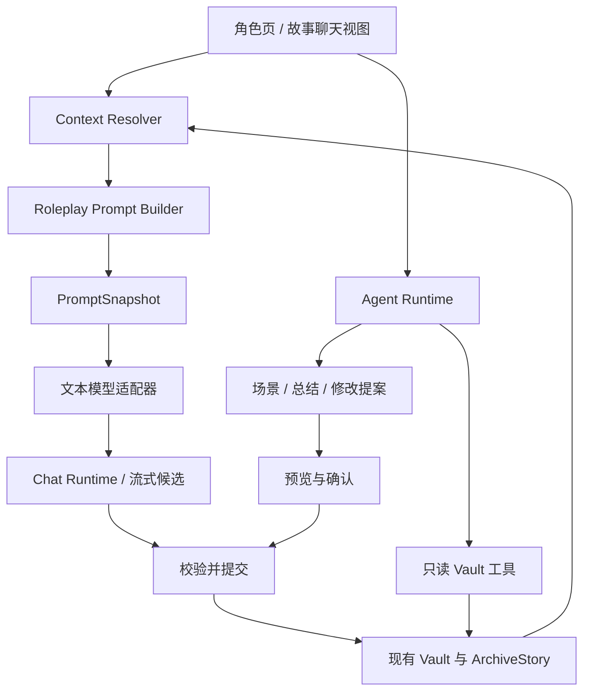

# STE 本地角色扮演工作台：设计与分期路线

> **状态：作废草稿，不作为实施依据。** 2026-09-12 用户纠正：接续遗漏了其最后一条对旧方案的否定意见，当前仍在讨论阶段。用户要求 Agent 进入每轮角色回复主流程，在用户发消息后自动激活相应世界书和记忆；本文将 Agent 放在普通聊天之外作为辅助调用，方向不符合该要求。尚未进入实施，文中所链实施计划未创建。以下只保留误接续时的草稿记录。

日期：2026-09-12。代码基线：`f0bc9f1`，STE `0.9.1`。

本文承接会话 `01a07c3f-43fc-7ff3-99dd-cb1b3b73b3b2` 中已讨论的产品方向，把“本地 Vault + 角色聊天 + 通用 Agent + 插图资产”具体化。本次交付为规划文档，功能尚未实现。首个可执行工作包见 [聊天运行生命周期实施计划](../plans/2026-09-12-chat-run-lifecycle.md)；后续子系统按下面的里程碑分别设计和实施。

## 1. 产品契约

STE 管理用户自己的角色、故事、分支、世界书、预设、记录和图片。普通聊天是主要使用路径；Agent 用于读取这些资料、生成候选产物以及执行用户选择的工作流。

本地优先指数据与控制权在本机。用户可以连接本地模型，也可以选择远程模型；选择远程服务时，只发送本次明确选入的上下文。导入、阅读、编辑、搜索和导出继续能够离线工作。

固定三条边界：

1. 普通聊天独立运行，Agent 失败不会阻断角色回复。
2. `ArchiveStory`、`ChatSession` 和现有 Vault 是正式数据的事实源。模型或 Pi 的会话历史不能成为另一套聊天档案。
3. 普通回复完成后自动提交；世界书修改、角色修改、图片绑定和批量整理先形成可预览的产物。自动配图属于后续可单独开启的策略。

第一条产品链路是：**角色页开始聊天 → 流式回复 → 保存故事 → 分析当前场景 → 推荐已有插图 → 确认绑定**。按阶段交付这条链路，不把所有子系统合成一次大改。

## 2. 实现方案与复用选择

| 方案 | 收益 | 代价 | 决定 |
|---|---|---|---|
| 扩展现有 STE 聊天与仓储，随后接入通用 Agent 包 | 沿用已有数据、编辑器、分支、导出；每阶段可独立交付 | 需要实现角色扮演 Prompt Builder 和宿主适配 | 采用 |
| 导入另一个角色扮演产品的完整运行时 | 能取得大量现成能力 | 数据层、界面和依赖耦合；不符合用户对 TauriTavern 直接复用的偏好 | 不采用 |
| 第一阶段同时自建 Agent Loop、插件和多 Agent 编排 | 控制面完整 | 延迟基本聊天交付，增加长期维护量 | 延后到有具体需求时评估 |

外部复用优先级：现有 STE 模块 → 可独立安装的通用依赖 → 有固定来源的小段 MIT 实现 → 自行实现。采用上游代码时记录原仓库、提交、文件、改动和原许可证；实际引入时再增加对应的第三方声明，不建立没有内容的声明清单。

SillyTavern 定义兼容目标；Pi 是 Agent 内核候选；TauriTavern 仅用于行为和失败场景对照。LangGraph、PydanticAI 等保留为长流程和结构化输出的设计参考，本期不加入依赖。

## 3. 已有代码可以复用什么

| 现有位置 | 已确认能力 | 接入时需要补齐 |
|---|---|---|
| `src/lib/png-parser.ts` | V1/V2/V3 卡片归一化、开场白、示例对话、系统提示字段 | 将归一化结果接入实时上下文 |
| `src/components/ai-tools/api-profiles.ts` | 唯一 Provider 配置入口、模型选择、系统配置镜像 | 单次请求冻结配置；本地服务的显式无鉴权模式 |
| `src/components/ai-tools/useOpenAI.ts` | 文本 Chat Completions、SSE、AbortSignal、采样参数 | 明确结束原因、取消清理、SSE 错误处理；未来工具协议另做适配 |
| `src/lib/preset-parser.ts`、`src/types/preset.ts` | 预设 round-trip、宏替换工具、激活顺序 | 运行时插槽、启用规则、角色卡覆盖和兼容诊断 |
| `src/lib/summary-engine.ts` | 总结上下文、深度注入、选定世界书条目 | 仅复用适合的纯函数；其角色插槽被跳过、世界书位置被简化，不能整体充当角色聊天引擎 |
| `src/lib/chat-edit.ts`、`src/components/chat/ChatPreview.tsx` | 编辑、隐藏、swipe 切换及原始字段同步 | 生成新候选、候选稳定 ID、流式草稿展示 |
| `src/lib/archive-db.ts`、`src/lib/story-draft-save.ts` | 故事写入队列、最新记录上的 mutation、分支读写 | 生成上下文冲突检查、幂等提交、持久化错误反馈 |
| `src/lib/repo/index.ts`、`src/lib/vault/vault-backend.ts` | IDB/文件库统一仓储、捕获源 Repo、故事真源与派生 JSONL | 运行记录和提示词快照 store、取消与换库边界 |
| `src/lib/vault/st-import.ts`、`st-update.ts`、`st-writeback.ts`、`src/lib/adapters/st/reimport-merge.ts` | ST 导入、更新检测、冲突合并、备份写回 | 对新生成消息与候选做回归，接入聊天入口 |
| `src/pages/StoryWorkspace.tsx`、`src/components/character/StoryListSection.tsx` | 故事工作区、分支、阅读和导出入口 | 增加聊天视图和继续聊天动作 |

两个容易误判的地方：能保存 ST 字段不等于能执行其提示词语义；已有同步模块也不需要重新建设一遍。第一阶段新增工作集中在上下文、生成过程和提交这三处。

## 4. 模块与数据流

建议新增目录 `src/lib/chat-runtime/`，按职责拆为上下文解析、提示词组装、模型适配、运行控制和提交。UI 订阅运行状态并发出命令；网络、仓储和 Prompt Builder 均不放进渲染组件。

Agent 放在后续的 `src/lib/agent-runtime/`，通过宿主接口取得快照和工具。外部框架类型只出现在适配边界，STE 的公共类型不继承 Pi 会话、工具结果或文件系统类型。

`Context Resolver` 每次取得当前角色、故事、分支、选定资产和用户人设的确定版本。运行期间源资料变化不改写这份快照；下次生成再取新版本。

## 5. 第一阶段的范围与兼容等级

第一阶段默认单角色、OpenAI 兼容的文本 Chat Completions。Provider 仍由现有配置管理。新故事使用 STE 自带的明确提示词骨架；导入预设需要通过对应兼容检查。

| 能力 | M1.3 首个聊天闭环 | M1.4 ST 基础兼容扩展 |
|---|---|---|
| 角色信息 | 描述、性格、场景、开场白、备选开场白、用户人设 | 加入卡片系统提示与 post-history 覆盖的对照样例 |
| 提示词 | 自带骨架；`{{char}}`、`{{user}}`；冻结实际 messages | 单人 `prompt_order`、8 类基础 marker、启用的普通块、深度注入、常见 `<START>` 示例对话 |
| 世界书 | 常驻和手动选定条目；明确展示入选范围 | 普通关键词、扫描深度、大小写与整词规则、基础选择逻辑，逐项通过固定样例 |
| 采样与长度 | 现有五个采样参数；输入预算、输出预留、完整历史轮次裁剪 | 导入参数的映射和诊断；兼容结果写进快照 |
| 聊天操作 | 发送、停止、尾部重生成、swipe、编辑、保存、重开恢复 | 与 ST 1.18.0 固定样例比对及生成消息 round-trip |
| 延后能力 | 群聊、文本补全后端、ST 扩展脚本、工具调用 | 向量触发、递归世界书、概率/组竞争、sticky/cooldown/delay、复杂宏继续独立扩展 |

ST 对照基线固定为 **1.18.0，提交 `8172dcd0ee672d3cd9a5e5f7af134f91a45cd2b8`**。该版本号与提交已查询；上表是计划实现的范围，不是已经完成的兼容声明。

未知字段继续原样保留。影响生成的未支持功能必须在生成前列出，并提供“改用 STE 基础预设 / 手动选择世界书条目”的明确入口；未作选择时不静默执行降级版本。独立的展示元数据不阻止生成。

历史只取当前分支选定的候选正文，排除隐藏楼层和 OOC 注释；正式 system 消息保留其角色。生成前先筛选并裁剪历史，再统一计算深度插入位置，避免多次插入导致同深度条目相互挤动。当前输入和必要角色设定不被无声删除；预算不足时要求缩小上下文或调高预算。

`estimateTokens` 属于估算。自带模式标明估算值并预留输出空间；没有模型对应 tokenizer 时不宣称精确 token 一致。M1.4 兼容样例对照最终 messages、条目激活与顺序，不比较随机生成的回复文字。

## 6. 用户操作与界面入口

角色页增加“开始聊天”；已有故事增加“继续聊天”，进入 `/story/:id?view=chat`。沿用同一个故事工作区和分支恢复逻辑。现有 `/chat` 工具页不作为新故事的第二套持久化入口。

聊天区只显示消息、输入框、停止/重试、候选切换和保存状态。角色、用户人设、模型、预设、世界书放入上下文面板。实际提示词和运行记录位于按需展开的详情中。

操作规则：

1. 开始聊天时选择一个开场白并保存为首条 assistant 消息；没有开场白时保存空会话，等用户输入。不因创建故事调用模型。
2. 用户输入落库成功后才发送模型请求。一次点击固定 userMessageId；重试同一次输入不再追加一条用户消息。
3. 正在生成的文本显示为候选草稿。完整回复自动提交，停止或失败的半条回复留在草稿中，用户可“保留到对话”或重新生成。
4. 重生成默认只面向尾部角色回复，保留原候选并追加一个新 swipe。修改较早回复的发展方向通过已有分支能力承接，保留后续原剧情。
5. 同一分支生成期间禁用会改变该分支上下文的编辑与候选切换。后台导入或其他入口仍可能改变资料，所以提交层必须再次检查。
6. 切换故事、分支或 Vault 时取消当前请求并保存已产生的草稿。返回后可以查看或手动处理草稿；不自动重发模型请求。
7. “生成完成”与“已保存”是不同状态。落库失败保留候选并提供重试保存；不能把错误吞掉后显示成功。

## 7. 数据契约

| 对象 | 归属 | 内容与边界 |
|---|---|---|
| `ArchiveStory` / `ChatSession` / `StoryBranch` | 现有正式数据 | 沿用主线与分支结构，主线 branchId 为 `null` |
| `StoryChatConfig` | 故事的可选配置，M1.1 新增 | Provider 引用、模型、用户人设、选定预设和世界书、预算、兼容等级；旧故事无此字段也可打开 |
| `PromptSnapshot` | 独立不可变记录，M1.1 新增 | 实际发出的 messages、采样参数、Provider ID、模型、输入来源版本/哈希、裁剪与兼容诊断、创建时间 |
| `GenerationRun` | 独立运行记录，M1.1 新增 | runId、目标故事/分支/session、操作类型、snapshotId、目标 messageId、variantId、基线正文指纹、候选文本、状态与时间 |
| `GenerationState` | M1.0 运行内存状态 | 当前进程的 scope epoch、事件序号和生命周期；不直接序列化作为完整运行记录 |
| `ArtifactProposal` | M3 起的候选产物 | 来源快照、目标、内容、基线版本和接受状态；正式提交后保留来源关系 |

`PromptSnapshot` 是实际生成上下文，与 `archive.ts` 已有的总结用 `GenerationSnapshot` 区分。快照不保存 API Key、Authorization、完整 Provider 配置或带凭据的 URL。凭据只在请求开始时从既有配置取出并冻结在内存中。

候选使用稳定的 `variantId`。生成提交时，在 `rawData.extra.ste` 与对应 `swipe_info[].extra.ste` 中保存必要的 runId/variantId；正式运行详情仍在独立记录里。旧消息在第一次需要候选绑定时补齐 ID 并保存，不按数组下标或每次解析出的新 UUID 充当永久候选身份。

文件库的 `故事.json` 是真源，`聊天.jsonl` 和分支 JSONL 是派生文件；重开 STE 继续读取真源，保留 messageId。导入外部 ST JSONL 会创建应用内 ID，因此 M2 的重导入合并必须显式维护已有锚点，不能重新解析后整体替换故事。

## 8. 持久化、取消与冲突

M1.1 增加 `chatRuns` 和 `promptSnapshots` 仓储。网页版注册到 `src/lib/idb.ts` 并幂等升级；文件库分别落在 `.ste/运行记录/<runId>.json`、`.ste/提示词快照/<snapshotId>.json`。在 `VaultBackend` 中登记独立路径与读取规则，不向未支持的 store 静默回退到 IDB。列表用轻量投影，打开详情再读完整文本。

生成开始时捕获源 `Repo`、Vault 身份、当前进程的 epoch、storyId、branchId 和 sessionId。所有排队操作使用捕获的 Repo。每次库激活或运行上下文重新建立都递增 epoch；A → B → A 也不能接受第一次 A 的迟到事件。`vault-scope.ts` 的 localStorage 键名隔离不能替代这个守卫。

正式提交按以下顺序执行：

1. 保存用户输入；准备并保存提示词快照和运行记录，成功后才发起网络请求。
2. 增量仅更新候选；运行记录最多每秒落盘一次，结束和显式页面切换时强制 flush。突然退出最多恢复到最后一次成功检查点，不承诺恢复尚未保存的字节。
3. 模型结束后先保存完整候选，再进入 `updateArchiveStory` 的串行队列。在队列内重读当前故事、检查源分支/session 和正文指纹。
4. 正文指纹只覆盖会影响本次上下文的消息身份、角色、正文、隐藏状态与选中候选；阅读位置、标签、收藏、标题等修改不造成生成冲突。角色和资产使用本次冻结的快照，下次生成再更新。
5. 先按 runId/variantId 检查是否已经提交。没有提交且基线一致时，追加消息或候选并同步 `mes/swipes/swipe_id/swipe_info`。
6. 故事保存完成后标记 run 完成。若在两次写入之间退出，重开时根据正式消息中的提交标记补齐运行状态，不再追加同一回复。

文件库不是跨文件事务。写入报错可能发生在真源已更新、派生 JSONL 尚未完成的时刻；恢复必须读取真源判定，再修复派生文件或运行状态，不能假定“抛错等于什么都没写”。

基线不一致进入 `conflict`，显示候选并允许复制或用于新分支；不覆盖新正文。分支/故事已删除同样保留候选，不自动重新创建被删除的对象。刷新后遗留的生成状态进入 `interrupted`；遗留的提交状态先核对正式提交标记，再判定完成或待重试。

## 9. Provider 与 Pi 的复用边界

普通聊天继续复用现有 Provider 配置与文本调用链，逐步把传输实现移到 `src/lib/chat-runtime/transport.ts`，原 `useOpenAI.ts` 保留兼容导出，避免总结、评分、世界书等已有调用点一起迁移。

文本传输需要明确区分 HTTP 错误、流内错误、有效结束、异常 EOF 和用户取消；覆盖 UTF-8/SSE 分片、CRLF、`data:` 后可选空格、无尾换行、`[DONE]` 后停止读取、reader 清理和 abort。已有实现只返回字符串，不可据此断言网络生命周期已经满足聊天要求。

本地模型增加显式 `authMode: 'none'`；旧配置默认仍为 Bearer，避免空 Key 被误当成所有端点都可匿名调用。保存能力矩阵区分文本、流式、工具调用、图片输入；能力由实际适配器与连接测试决定。

截至本次核验：

- 旧包 `@mariozechner/pi-agent-core@0.73.1` 已标记弃用，指向新包。
- 当前发布候选为 `@earendil-works/pi-agent-core@0.85.1`，MIT；发布提交为 `d981de1229ef899957bbe968bc8dcda02a21f477`。
- 当前包必需依赖 `pi-ai`、`chord`、`pi-telemetry`、`typebox` 等，入口还导出 harness。不能沿用“只装一个很薄的 core，pi-ai 完全可选”的假设。
- 包声明 Node `>=22.19.0`，本机当前 Node 为 `22.14.0`。M3 的验证需使用满足要求的隔离工具链，普通聊天阶段不受此影响。
- Pi 的 `StreamFn` 返回 `AssistantMessageEventStream`，包含消息、工具调用与终止事件。STE 当前 `Promise<string>` 不能直接作为该函数。

M3 先做一个有明确结论的适配验证：固定候选版本和锁文件；最小 Vite 浏览器入口只导入所需 Agent 与 Provider；验证构建产物没有无法执行的 Node 路径；测量新增初始加载与懒加载体积；用假模型跑完整的“工具调用 → 只读工具结果 → 最终文本”、取消和异常；再验证真实选定 Provider 的工具能力。

验证报告必须列出 Node 要求、传递依赖、网络行为和许可证。遥测依赖的存在本身不代表会发送数据，需要检查实际默认行为。STE 的 Agent 功能按需加载；任何外发遥测都不能由依赖隐式开启。

通过后优先直接安装包，由 STE 适配 `AgentMessage`、`convertToLlm`、事件和工具。若默认入口无法在目标环境干净运行，则比较受支持的入口与带来源声明的最小实现复用；不偷偷依赖未导出的内部路径。自动重试、断点恢复和持久化日志均由具体契约与测试确认，不能因为 Pi 有 `continue()` 就视为全部具备。

## 10. 只读 Agent 与图片资产

M3 的工具仅开放 `vault.search`、`vault.read_character`、`vault.read_story`、`vault.read_worldbook`、`vault.read_notes`、`vault.find_assets`。工具通过捕获的 Vault 与既有仓储访问 ID，参数和结果有 schema、大小上限、取消和错误语义；不暴露任意文件路径、终端或通用网络执行能力。

Agent 输出首先进入 `ArtifactProposal`。总结可采用已有总结类型；场景识别输出人物、地点、动作、情绪和标签，以及来源的消息与候选锚点。结构化输出不合格时显示失败并保留原始候选，不直接写世界书。

插图分三步交付：

| 步骤 | 可用能力 | 数据处理 |
|---|---|---|
| M4.1 本地推荐 | 检索现有立绘、附件中可用图片和手动导入图片 | 建立资产目录适配层；复用已有文件，按内容哈希去重 |
| M4.2 本地生成 | 调用用户已配置的 ComfyUI 等来源适配器 | 保存提示词、模型/工作流、seed 与输出来源，再进入候选图包 |
| M4.3 远程来源 | 用户开启并选择来源后搜索/下载图像 | 宿主来源适配器执行网络访问；保存 URL、作者、许可状态和哈希 |

`ImageAsset` 区分 Vault 相对路径与网页版 Blob 存储；来源信息允许“未知”，不推断或伪造作者与许可证。`SceneCue` 记录具体候选的场景。`IllustrationBinding` 使用 `{ storyId, branchId, sessionId, messageId, variantId, assetId }`，避免 swipe 切换后套用另一候选的插图。

已有 `PortraitRow` 和附件继续保持各自的数据所有权。资产目录提供统一检索视图，导入独立图像时才创建新资产；不先批量迁移所有角色图片。

图片通过绑定关系显示，保持聊天文本独立。纯 ST 导出忽略 STE 插图绑定；带图导出和阅读包导出显式携带图片目录与映射。删除某次绑定不自动删除全局图片；清理资产前检查所有引用。

## 11. 分期路线与完成条件

| 工作包 | 主要改动位置（新增项为规划路径） | 依赖 | 完成条件 |
|---|---|---|---|
| M1.0 运行生命周期 | 新增 `src/lib/chat-runtime/generation-state.ts` 与独立测试 | 无新依赖 | 迟到/重复事件隔离、取消保留、保存失败与冲突状态可测试 |
| M1.1 持久化与提交 | 新增运行记录类型、run/snapshot 仓储、提交模块；扩展 `src/lib/idb.ts`、`src/lib/vault/vault-backend.ts`、`src/types/archive.ts` | M1.0 | 两后端重开、源库捕获、幂等提交、失败恢复；旧库可读 |
| M1.2 基础上下文与传输 | 新增 context/prompt/transport 模块；复用 `png-parser.ts`、`api-profiles.ts`、`useOpenAI.ts` | M1.1 | 自带骨架可发一轮文本；快照与实际请求一致；本地无 Key 模式、取消与流错误通过 |
| M1.3 普通聊天界面 | 新增 `src/components/chat/ChatConversation.tsx`；接入 `CharacterPage.tsx`、`StoryWorkspace.tsx`、`editor-story-context.ts` 与消息展示 | M1.2 | 选择角色、发送、停止、重生成、swipe、编辑、刷新恢复的完整用户路径 |
| M1.4 ST 基础提示词兼容 | 新增兼容诊断与固定 fixtures；按需抽取现有纯函数 | M1.3 | 第 5 节支持项逐一通过 ST 对照；未支持项可见且不会被静默执行 |
| M2 ST 伴侣链路验收 | 接入已有 import/update/merge/writeback；补生成候选及命名空间导出回归 | M1.4 | STE 生成 → ST 导入 → ST 修改 → STE 合并；保留未知字段、已有候选与锚点 |
| M3 只读 Vault Agent | Pi 验证后新增宿主适配、只读工具和产物记录 | M1.3；M2 提供兼容回归 | 无资料越界、可取消；总结和场景产物可预览；Agent 关闭时聊天仍可用 |
| M4 插图闭环 | 资产目录、场景产物、候选图包、按候选绑定 | M3 | 当前场景推荐本地图并确认绑定；切 swipe/分支/重开后对应正确 |
| M5 固定工作流 | 总结、章节、角色记忆、世界书修改提案 | M3/M4 | 每种工作流有明确输入范围、停止、恢复和提交行为 |

同一代理按上述依赖顺序执行即可。每个工作包结束记录验证结果再开始下一个；不把 Agent、图片或同步验收的缺口记作普通聊天已完成。多 Agent、MCP、后台常驻抓图和全量 ST 插件兼容不在这条首发路线内。

M1 的自动化回归集中在 Prompt fixtures、传输故障、运行状态、候选同步、两种仓储与原有编辑/分支/总结。用户路径需在浏览器和 Tauri 壳实际验证；Android 如果未运行则单独记录未验收，不能用 jsdom 代替设备结论。

## 12. 首个实施包 M1.0 的精确范围

M1.0 只交付一个无副作用的生命周期模块及其测试。没有网络、React、磁盘、Pi 或实际故事提交。其作用是让下一工作包有确定的状态和事件边界。

- **R1 身份**：每次运行固定 runId、vaultId、epoch、storyId、branchId、sessionId、目标 messageId 和 variantId。新运行从 `preparing` 开始。
- **R2 隔离与重放**：事件包含完整 scope、runId、单调递增序号和时间。身份不符、非法序号、旧序号、重复序号一律忽略；不复制旧事件到新运行。
- **R3 文本生命周期**：准备成功进入 `streaming`，仅流式状态接受增量；模型完成进入 `ready`。最终空白文本进入 `failed`，不能提交空回复。
- **R4 停止与中断**：`preparing/streaming/ready` 可取消；`preparing/streaming` 可标记中断。保留已经显示的候选，之后的模型事件不再改变它。
- **R5 显式保存**：`ready/cancelled/interrupted/failed/save_failed` 在候选非空时可接受宿主的 `commit_started` 命令；其中不完整候选必须由 UI 的用户动作触发。Reducer 本身不自动开始保存。
- **R6 保存结果**：只有 `committing` 接受保存成功、失败或冲突。失败进入 `save_failed` 并保留候选供重试；冲突进入 `conflict`，不能自动再提交。
- **R7 完成与纯函数**：完成状态拒绝后续事件；错误转换保留候选与身份；不修改传入的 state、scope 或 event，不读时钟、不生成 UUID。
- **R8 职责边界**：此模块验证应用内事件，不能替代 AbortController、仓储捕获、正文指纹、断点核对或跨文件提交协议。运行记录由 M1.1 显式映射，epoch 仅在当前进程有效。

宿主为同一运行串行分配事件序号；非法状态的事件不推进状态或序号。`commit_started` 在宿主重新确认当前目标后发出，模型流无法直接产生此命令。冲突候选转新分支时创建新的运行身份。

## 13. 核验来源

- [ST 1.18.0 对照提交](https://github.com/SillyTavern/SillyTavern/commit/8172dcd0ee672d3cd9a5e5f7af134f91a45cd2b8)，[该提交的 package.json](https://github.com/SillyTavern/SillyTavern/blob/8172dcd0ee672d3cd9a5e5f7af134f91a45cd2b8/package.json)。已核对版本，运行时 fixture 验证属于 M1.4。
- [Pi 0.85.1 发布包元数据](https://registry.npmjs.org/@earendil-works%2fpi-agent-core/0.85.1)，[旧包弃用信息](https://registry.npmjs.org/@mariozechner%2fpi-agent-core/0.73.1)。
- [Pi 发布提交的 package.json](https://github.com/earendil-works/pi/blob/d981de1229ef899957bbe968bc8dcda02a21f477/packages/agent/package.json)、[Agent 类型](https://github.com/earendil-works/pi/blob/d981de1229ef899957bbe968bc8dcda02a21f477/packages/agent/src/types.ts)、[默认入口](https://github.com/earendil-works/pi/blob/d981de1229ef899957bbe968bc8dcda02a21f477/packages/agent/src/index.ts)。
- [Pi MIT 许可证](https://github.com/earendil-works/pi/blob/71dca871bc80b6bc97be37f0ca3189399d651fff/LICENSE)。另核对了该 main 提交的 README；正式依赖以发布包和锁文件为准。
- 本地证据记录于 `.planning/roleplay-runtime-20260912/findings.md`。未安装 Pi、未升级 Node，也未声称完成其浏览器或 Tauri 验证。
