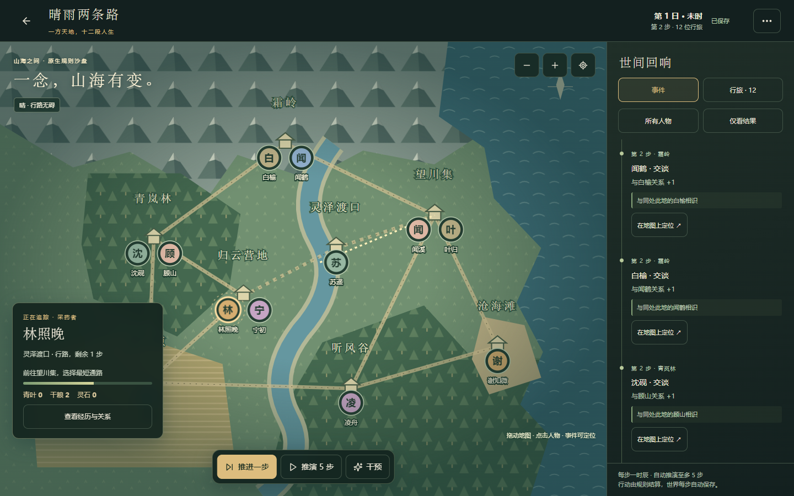

# v3 Batch 0＋1：独立规则沙盘交付核验

2026-11-07 · Codex。用户正式批准 v3，并明确授权 Batch 0＋1。原两轮多态实现保持撤回；本批从回退后的源码新增原生世界。基线 `codex/playtest-20261031` / `01686330ad5e64b2ec2f90e257dabe813afbf7f1`，包含原有未提交内容；本批未提交、推送、打包或发布。用户尚未验收实际可玩性。

## 从哪里体验

开发/预览页面：聊天 → **山海之间** → 开辟新世界 → 启程。`/worlds` 为世界列表，`/worlds/:id` 为独立地图。没有模型连接也能完整运行。桌面为地图＋右侧事件，390px 为地图＋底部可展开事件；人物、地区、事件都可选中。

建议首先比较同档晴雨两条路：

1. 默认种子 73，新建后推进 2 步，追踪林照晚，可见从归云营地经灵泽渡口去望川集。
2. 右上行囊 → 回看世界 → 选择第 0 步 → 查看此刻地图 → 从这里分支。
3. 干预 → 灵泽降雨 → 确认并推进。再推进 2 步，林照晚改走青岚林。地图、剩余行动时间和事件原因来自同一个结算结果。
4. 从地区入口投放补给或召集行旅，观察同处后的交谈、赠予、互助与资源竞争。人物详情显示库存、体力、修为和关系。
5. 可推演 5 步、暂停、留下路标、回看/分支、导出/导入、移入回收站/恢复。

[390px截图](fixtures/play-world-b01/mobile.png) · [390×560短视口](fixtures/play-world-b01/mobile-short.png)

## 已实现的真实边界

- 8 地区、12 人、青叶/干粮/灵石 3 种资源，8 类动作：移动、采集、歇息、修行、交易、赠予、交谈、援助。采集争抢和市集最后库存都串行结算，失败方不扣款；赠予/交易是转移，修行有明确消耗，玩家补给是外部新增来源。
- 原创 SVG 地形、图标头像和路径。不下载图片、不复用参考仓库代码/美术、不新增 npm 依赖、不解码角色卡差分。人物按需求和目标行动；角色卡人设、私密知识、模型规划和文学演出属于后批。
- 有种子的纯规则函数在 Worker 运行。位置/事件在保存成功后显示；动画仅插值已提交状态。自动最多 5 步，暂停丢弃未提交计算；写入已开始的一步完成后停车。页面离开、后台或切库停止推演，没有离线补算。
- `WorldRepo` 为独立集合，直接使用现有 VaultFs，未借用故事/角色目录或 `roleplayFiles`。桌面为 `世界/<UUID>/<六位版本>.json`；网页/Android 使用 IDB v12 `worldCommits`，`worldId` 索引。每条提交含当前状态、本步事件、命令、父 hash 和自身 SHA256；不重复累计全部历史事件。
- Vault 临时写入、回读校验、不可覆盖 rename 发布；IDB 同事务比对父版并 add。无可丢失的可变 HEAD。重开从连续有效链恢复；损坏尾部只读并可从完整版另存分支，坏文件保留。追加只读取父版正文，避免每步反复读取历史。
- 回放不重算、不调用模型。分支复制所选状态并记录父世界/版本/hash，不复制或修改原世界；起点以前的事件从原世界查看。回收站以墓碑提交实现，保留全部历史，无自动物理清空。有效世界文件被现有文件维护识别；损坏/未知附件保持保护。
- 独立备份导入创建新世界，完整链一次性发布。网页整库备份包含世界；恢复同 ID 世界按整条历史原子替换，确认页列出撤回版本数，损坏链拒绝整次导入。文件库世界请在行囊导出，或备份库中 `世界/` 目录；原有设置中的 IDB 备份不冒称文件库整库备份。
- 酒馆正在生成时，世界入口等待结束；就绪后保存编辑、草稿及 host，再卸载 iframe。保存失败保持聊天与重试入口。修复初始化未完成时旧后台保存抢先 flush 的竞态。普通离开聊天到资料库仍保留原后台会话行为。

## 验证与证据

| 范围 | 实际结果 | 可支持的结论 |
| --- | --- | --- |
| 最终 Vitest 全量 | **300 文件 / 2465 项通过** | 规则确定性、持续移动、路径/天气、采集及交易争抢、资源转移、160步库存非负、存档/并发/损坏/分支/备份/切库、聊天初始化与保存门槛，以及原有功能回归 |
| TypeScript / ESLint / Vite production build | 通过；Vite 保留已有大 chunk 等建议 | 应用类型、变动范围静态检查和产物构建；不是原生打包验收 |
| Edge 实际应用，隔离 IDB | **8组流程通过，0页面错误** | 真实入口、新建、Worker推进、晴雨路径分歧、路标/重开/回放/分支、5步上限/暂停、导入导出/恢复、390px/短视口/触控、事件追踪 |
| 实际 ST iframe | 浏览器真实打开测试卡，输入草稿，进入世界后 iframe 与 host 数量归零，正文保留 | 标准聊天到世界的真实切换；没有模型调用，未声称完整插件生成组合重测 |
| 页面接内存 Vault | 创建/推进写入2个版本；切新库后旧新库无串写 | UI到VaultFs接口链成立；不是 Windows 真实磁盘验证 |
| 最终生产页面 | 独立 Worker、干预、重开及390px通过；无 `/src/` 请求/页面异常 | 打包后的浏览器资源路径可用 |

执行命令：`node node_modules/vitest/vitest.mjs run --reporter=dot`、应用 `tsc --noEmit`、变动范围 `eslint`、`npm run build`、`node scripts/smoke/playtest-20261107-world.mjs`、`node scripts/smoke/playtest-20261107-world-production.mjs`。

浏览器[结果](fixtures/play-world-b01/browser.json)、[生产结果](fixtures/play-world-b01/production.json)、[本批文件SHA256清单](fixtures/play-world-b01/source-manifest.json)。完整本机日志在 `.cache/play-world-*.log`；实施前914项哈希与文件副本在 `.cache/play-world-b01-before/`。本批修改9个原文件、新增14个源码/测试/Smoke文件、删除0个基线文件；原先未提交内容保留。图片与界面均是本批原创，没有使用修仙参考项目素材。

## 当前容量与待验收项

单世界最多 2000 次追加版本，到限可另存分支继续；单独导入上限32MB。事件流最多展示当前筛选最近100条；完整历史保存在提交中。当前完整状态每版一份、打开时校验全链，适合12人的小世界；没有把它描述成大规模无限人口或多年历史方案。资源有限且不会隐式刷新，可通过补给干预继续实验。

未做本轮 Windows WebView2 真实磁盘、窗口关闭中断与 Android 真机验收，也未做数小时持续运行。原生窗口控制、导出/分享和关闭等待已接现有机制，测试边界如上。完整大型地图素材、角色智能/私密记忆、角色接管冒险、GAL 和跨作品卡片导入均属于 Batch 2～5，未偷偷启动。用户实际试玩决定这一版是否有观察和干预价值。
