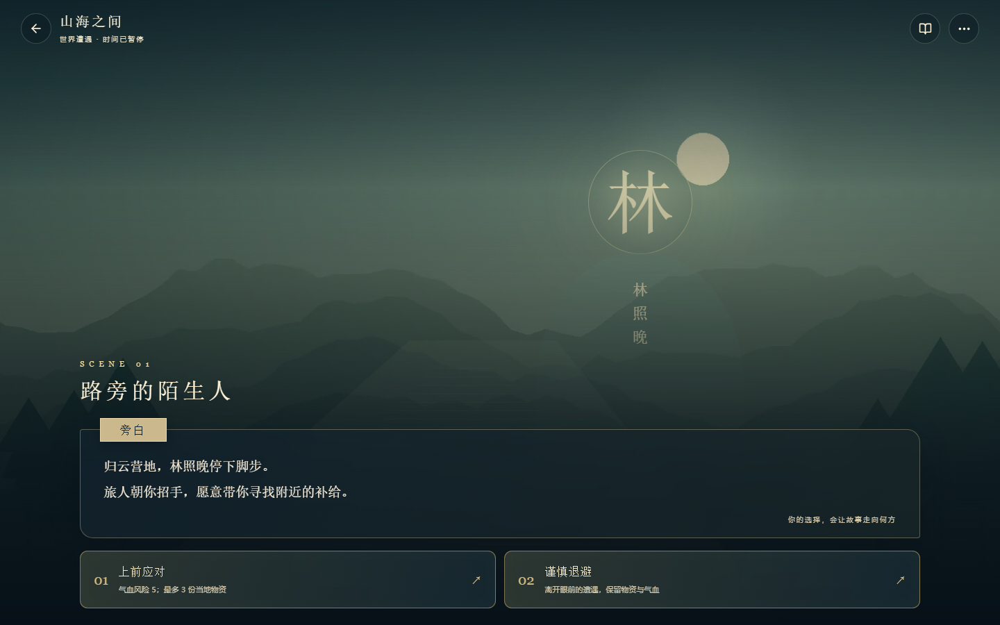
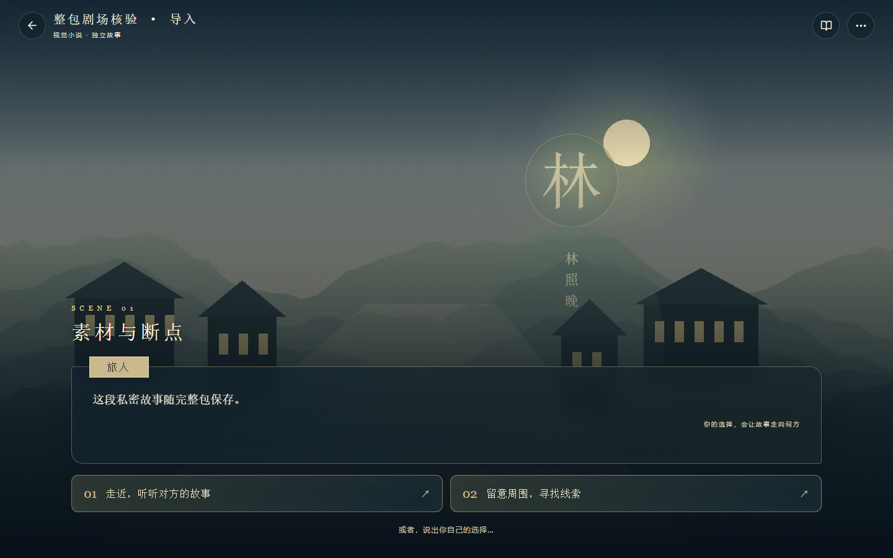
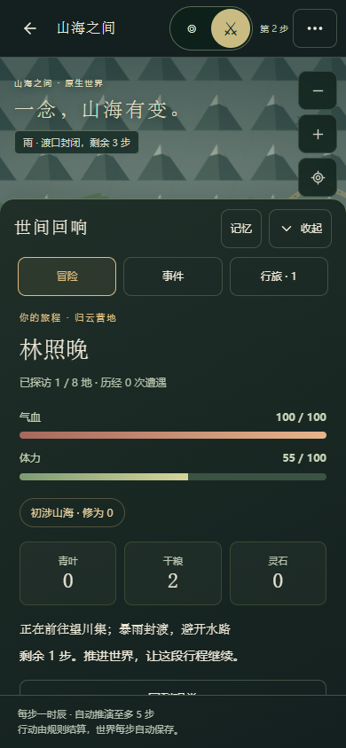

# v3 Batch 2～5：统一源码交付与实测报告

后续交付：已合并 main 并制作 **0.9.9 Windows 安装版与免安装版**，正式程序、双包互读和卸载验证见[合并与打包报告](2026-11-07-release.md)。以下为源码批次当时的范围与证据。

2026-11-07 · Codex。用户在确认 Batch 0＋1 后授权连续实施后续四批，统一交付实测。本轮交付独立世界中的人物智能与记忆、角色冒险、跨作品休息室、独立 GAL 和整包保存；不恢复此前否决的聊天外挂实现。**源码实施与自动检查已完成；可玩性待用户实测，Android 真机尚未验证。**

分支 `codex/playtest-20261031`，HEAD `01686330ad5e64b2ec2f90e257dabe813afbf7f1`，包含本轮和此前未提交内容。基于 Batch 0＋1 的 928 项源码/脚本/资源快照比对，本轮修改 17 项、新增 56 项、无基线文件删除；不是相对 HEAD 把所有既有改动计成本轮。文件及 SHA256 见 [源码清单](fixtures/play-world-b25/source-manifest.json)。实施交付时尚未提交；用户随后授权 Git 收尾，源码已按基础/规则沙盘/后续四批拆分提交并推送至 `codex/native-play-world-v3`，实现提交为 `70dfcda`，见[Git交接](../maintenance/2026-11-07-git-closeout.md)。未发布或制作新安装包；Windows 核验使用隔离标识的 debug/no-bundle 程序。

## 从哪里体验

在开发源码运行 `npm run dev`，打开聊天页 → **原生世界**。原有 11 月 6 日正式 0.9.8 安装包不包含本批功能。

| 路线 | 实际操作 | 应看到的结果 |
| --- | --- | --- |
| 人物智能 | 开辟新世界 → 右上行囊 → 人物智能与额度 → 人物自主思考 → 选已配置连接 → 确认并开启新额度 → 推演 5 步 | 12 人公平轮转，每步至多 4 位闲置人物思考；地图行动仍受路径、时间与物资规则约束。关闭旁白可减少调用 |
| 透明记忆 | 地图侧栏“记忆” → 剧情时间线 / 状态与事件 | 时间线可选已有故事的小总结、日记、章节并跳楼层；短事实有启停、修订、删除恢复、待确认与期限。长原文不会默认注入 |
| 下场冒险 | 追踪人物 → 顶栏剑图标 → 选择探索或其他合法行动 | 血量、体力和背包按规则变化；探索完成出现遭遇，可应对/退避，也可进入事件剧场；重开保持接管及冒险面板 |
| 跨作品休息室 | 世界列表 → 主神空间 → 行囊 → 召唤与来客档案 → 选卡并确认映射/短事实 | 最多 4 位来客进入 8 处日常地点；与原有居民共同走动、交谈、赠予和互助。源卡更新有提示，原文件不写回 |
| 独立视觉故事 | 世界列表 → 视觉故事 → 选卡与开场 → 创建 | 全屏 Scene/Beat/Choice 舞台；读同场对白不调用模型，选择分支才续写。背景、立绘、历史、支线、保存和自由行动在剧场内操作 |
| 带走与恢复 | 世界行囊导出备份，或剧场行囊导出完整故事与素材 → 世界列表导入 | 新世界恢复原剧情、人物私密记忆、素材和断点。公开分享是单独入口，只输出清理过的当前沙盘快照 |

首次建议先用规则模式体验“探索→遭遇→剧场→返回”，再启用模型比较人物目标和旁白。规则模式不联网；真实模型延迟、输出质量与费用取决于连接，人物规划不承诺每次产生戏剧冲突。

## 四批具体落地

### Batch 2：人物决策、叙事、记忆与预算

- `src/play/agents/`：`intelligentStep`、`WorldModelGateway.request`、人物上下文投影和持久预算。模型只能返回 `availableActions` 中的合法 actionId；持续行动不重复询问，接管角色不被 NPC 调度替代。
- `src/play/memory/`：所知事实与事件可见性、短事实编辑/状态管理、既有故事总结适配；人物各自只携带其人设和已知事实，公共旁白不携带人物秘密。角色在路上不会继续“目击”出发地点的新事件。
- `WorldMemoryConsole`：剧情时间线与事实卡片同级，正文搜索、来源跳转、事实 Switch/修改/删除恢复。默认新事实为空白一句话；已有小总结不超过 240 字可引用，较长内容要求提炼。回顾不自动变成提示词约束。
- 后台定期提炼直接挂在当前推演维护步骤：默认每 6 步，最多 3 条候选，必须确认。人工与候选最多 160 条，总事实集合最多 500 条；旧目击事实按上限滚动，完整事件仍在存档中。
- 接管默认本人视角；地图只显示附近人物，远方保留地理而不展示实时库存。记忆可显式切换导演全知；这是本地单用户的信息视角，不是防止文件拥有者读取数据的访问控制系统。

默认额度为 30 请求 / 64,000 tokens / 5 分钟；单请求 30 秒，输出上限 2,048，可在高级项调整 256～4,096。先持久预留再发请求，可靠 usage 按服务用量结算，取消/超时/无 usage 按预留保守记账。模型调用不自动重试；中断或耗尽需用户明确继续/开启新额度。人物规划输入上限 2,000 tokens，其他任务 3,000；超限明确报错。规划上下文按固定上限取人设字段（身世900/性情400/私密笔记1000/心愿300字符）与最近8条已启用所知事实；完整人设仍保存在本地，实际发送内容和事实ID可查，长人设并非全量装入。

规则结算先保存，之后生成公共文学旁白；旁白失败不会倒退已完成世界。调用凭据保存事实 ID、上下文版本与用量；实际载荷仅在当前内存保留最近 20 条，敏感密钥脱敏，导演界面按需展开。完整备份包含人物私密资料；公开快照不带这些凭据。

### Batch 3：冒险和休息室

`src/play/adventure/{control,perspective}.ts` 管理唯一控制权与角色视角，`simulation.ts` 结算探索、遭遇、物资和受伤。探索持续两步，面对/退避只结算一次，风险和最多所得先展示。受伤可休息恢复，无永久卡死；它是极简冒险规则，不是完整修仙战斗/装备/任务系统。

`src/play/sanctuary/summon.ts` 提供 8 处休息室地图、日程与跨作品人设映射。只在选定角色时读取源卡，最多携带 8 句确认事实。更新同源人物保留经历；换人清理原位置秘密与旧关系，不能把上一个人物私密资料继承给新来客。召集干预覆盖日程 12 步，随后恢复日常。源卡的“全知/无敌”文字不改变规则权限。

### Batch 4：独立 GAL 与事件剧场

`src/play/gal/{scene,story-adapter,generate-scene}.ts` 验证 Scene/Beat/Choice 图：2～4 选项，拒绝断边、循环和不可达对白。阅读推进零模型调用，选项先保存 pending，立即锁定；失败可续上次选择。当前状态最多 24 场、100 次选择，完整历史仍随各版本保存。

`src/pages/GalPlay.tsx` 与 `components/play/gal/` 是独立路由 `/gal/:id`，没有 ST iframe 或聊天气泡。毛玻璃对话框、渐变遮罩、数字行动卡、触控反馈、可跳过打字机、历史与分支均有真实入口。世界遭遇剧场暂停世界并把选择交回同一规则事务；角色卡开视觉小说则创建派生会话，不改原故事。

素材使用 12 张本地原创程序化 WebP 背景，共 **121,538 字节**。没有参考项目代码/素材移植，也没有把占位字符称为完整角色立绘库。可选卡面、本地图片与外部目录中的单张图；无图显示姓名意象与渐变。表情差分联动、生图、TTS 和预生成分支不在本批内。

单张先验 PNG/JPEG/WebP 文件头尺寸，禁动画/SVG，≤4 MB、≤800 万像素、边≤4,096；导入缩至≤1,920×1,600并重编码 WebP。不可变 SHA256 资源独立保存；舞台按需加载并使用 **32 MiB 估算 RGBA 缓存**、引用 pin、淘汰/卸载释放 ObjectURL。这个限额不等于 WebView/GPU 总显存上限。

### Batch 5：保存、恢复与平台接线

- `world-repo.ts` 逐条验链，保留最新完整状态与轻量索引；页面最近 100 事件，索引最多 10,000 条。回放按版本读取，不在内存复制所有世界快照。坏尾保留原件，另存最后完整版本后继续。
- `.ste-world` v2 使用逐提交 gzip/Base64，与 `.ste-play` 分开；整个包≤32 MB、≤2,001 提交、≤128 素材；逐提交解压≤1 MB，防解压炸弹。达到历史容量后需另存分支，不宣称无限存档。
- 完整备份保留私密人设/记忆/剧情/素材；公开分享重新建立单快照，剔除历史、人设、私密记忆、调用凭据、冒险、剧场/素材与来源引用，并保留公开事实期限，避免复活过期事实。
- IDB 升至 13，增加 worldMedia；桌面 Vault 保存至世界及世界素材集合，整库备份与文件清理共同保护素材。
- 浏览器离开/隐藏、Android 返回与后台事件停止推演；Tauri 关闭等待保存。GAL 适配 visualViewport 与输入法 composing。Android 沿用既有 IndexedDB 和单文件分享导入导出路径，**未新增桌面 Vault 的 Android SAF 目录实现**。

## 标准酒馆兼容矩阵

| 能力 | 标准聊天 | 独立世界 / GAL |
| --- | --- | --- |
| 普通卡、预设、主绑定世界书 | 保留当前 ST 通道与原有装配 | 只导入已确认人设/开场/短事实；不宣称原版预设/世界书激活等价 |
| 原版助手、MVU/schema、SPreset 工具正文 | 本批实际扩展脚本＋固定模型响应验证通过，变量保存重开一致 | 不执行这些扩展；世界规则为权威 |
| 作者 HTML/DOM 前端 | 留在标准通道，原入口保留 | 不把作者脚本搬进舞台，也不隐藏 iframe 冒称无头 |
| 故事与分支 | 原存储不迁移 | 新会话派生，引用来源但不写回；切换等待 ST 保存完成 |

这次的边界是原生游戏视图与明确的标准兼容通道，完整无 DOM ST 抽离仍是独立工程。

## 自动检查与真实入口证据

| 检查 | 结果与边界 | 证据 |
| --- | --- | --- |
| Vitest 全量 | 305 文件 / 2,488 项通过；首轮并发导致一项 5 秒超时，单独复现通过，4 workers 全量通过。随后仅补冒险重开面板的 3 行 UI 恢复，由最终生产与恢复 smoke 覆盖 | `vitest-full.log` |
| 类型 / lint / Node | 应用与 Node 类型通过，变动范围 lint 通过，Tavern Node 源码 54 项通过 | `types.log`、`lint.log`、`node.log` |
| 源码浏览器 B25 | 5 组：真实 Worker/剧场一次结算、记忆、出站/预算、召唤、GAL 防双击/零调用/断点/390px；6 次固定响应 | `browser.json` |
| 恢复浏览器 | 11 组：已有三类总结与实际楼层30定位、回放/分支、公开包、完整包跨库/素材、目录图、跨作品日程/社交、坏尾、本人/导演视角、非首位接管恢复、回收 | `recovery.json` |
| 最终生产页面 | dist 路由、构建 Worker、降雨、冒险重开、完整 GAL 包/素材/历史/返回、390×844/390×480；无 /src/ 请求或 pageerror | `production.json` |
| 标准扩展 | 原版助手、实际 SPreset/MVU/schema 脚本、固定模型响应，变量落盘重开；不是本轮真实插件模型质量测试 | `extensions.json` |
| Windows WebView2 | 隔离标识 `com.ste.explorer.world1107`，真实磁盘保存/正常关窗/重开/整包素材、HTTP 停止/超时/预算熔断；3 次本地 HTTP 请求，无自动重试，原配置 hash 一致 | `native.json` |
| Android | 返回/后台生命周期桥接单测、390px与短视口浏览器通过；无 adb/设备，未完成真机输入法、SAF、系统分享/杀进程验证 | `play-lifecycle.test.tsx` |

证据文件集中在 [本批目录](fixtures/play-world-b25/)。生产构建与原生编译均通过；原生重编译的一次 npm 参数转发错误发生在 Cargo 接收参数阶段，改用直接 Tauri CLI 后执行；失败日志保留，未修改正式标识或安装程序。

## 真实模型与费用

使用已配置的 nebius `deepseek-ai/DeepSeek-V4.1-Flash`，仅发送本批虚构人物/事件，未发送用户真实故事或改变原连接配置。合计 **17 次 / 14,943 tokens；14 次成功、3 次失败**，失败计费和证据保留。

- 首轮输出 256：5 次请求中 2 次无正文、3 次合法行动。不能把 HTTP 200 当作生成完成。
- 调整后的人设对照使用输出 1,024：三种人设同情境各 3 次，守成者 rest×3、探路者 move:ferry×3、修行者 train×3；9/9 合法，7,536 tokens，约 1.1～6.6 秒。它证明受控人设差异，不证明长期剧情质量。
- 旁白与 GAL 抽样：1,024 时旁白截断，GAL 返回 4 段对白/4 选项；显式调为 2,048 后旁白成功，约 13.53 秒、1,511 tokens。当前默认 2,048；过低输出会明确提示用户调整，不在后台自动重试。

各轮模型/参数/usage/实际文本见 `real-initial.json`、`real-personas.json`、`real-prose.json`、`real-narrative.json`。价格取决于服务商，本报告不臆测金额。

## 负载与长时运行

12/50 人各超过 11,000 条事件，索引分别 9,994/9,944，页面≤100。真实浏览器读取约 1,267/1,233 ms；单步中位 145/194 ms、P95 463/294 ms；GC 后 JS heap 约 25.45/26.45 MB。50 人仅用于压力测试，产品新世界仍 12 人。记录了 Windows 浏览器/渲染器/GPU 进程 working set、CPU 时间和 headless rAF，**不把约 120 rAF/s 当成手机实机帧率，也不把 GPU 进程内存当独立显存计量**。见 `load.json`。

一小时真实UI持续测试已完成：**3600.6 秒，740 步，37 次地图→列表→GAL→列表→地图往返，0 pageerror**。加载自选素材并在往返时卸载；采样时事件DOM≤100、iframe为0，热身后DOM保持1,013、监听器401；GC后JS heap约21.48～26.37 MB，包含持续增长至上限的事件索引。没有将这些数值称为全进程内存或永久无泄漏保证。见 `soak.json`。

首轮第620步重新载入地图超过脚本5秒等待，失败证据保留（`soak-first-failure.json`）。最终轮用真实导航和30秒载入等待，重新完整运行一小时；不是删除失败记录后补写成功。

长时证据有范围：运行起点之后调整了人物视角、坏档恢复、目击范围、召集优先级、记忆期限、模型输出上限与冒险面板恢复；Worker 生命周期、媒体缓存释放、轻量索引机制没有改变。六个起始身份文件已逐一核对，差异保存在 `soak-boundary.json`。最终短 smoke 覆盖这些行为修补；不把这一轮说成所有最终代码均运行了一小时，也不外推为永不泄漏。

## 联合审查后实际修补

在途人物不再知道出发地新事件；休息室召集在有效期内优先于日程；编辑停用事实不会重新启用；公开快照不复活已失效事实；GAL 坏档与回收档不循环跳路由；接管默认本人，非首位接管的事件筛选正确，导演时间线可显式恢复全量视图；剧场补回收入口；既有小总结跳楼层保留导航 state；重开接管档恢复冒险面板。各项有相应逻辑或真实入口回归，未把仅存在某字符串视为交互验证。

## 还需要统一试玩判断的事

模型规划是否形成值得持续追踪的人物、干预是否有趣、简单遭遇是否足够、地图/舞台是否达到参考方向，需要用户体验评价。当前是原创极简世界和素材，无宗门战争/完整修仙经济、完整立绘表情系统、后台社交圈或任意角色卡自动生成地图。新增范围和剩余平台缺口均按实际记录，不能以功能数量或绿色测试代替产品验收。

截图：

