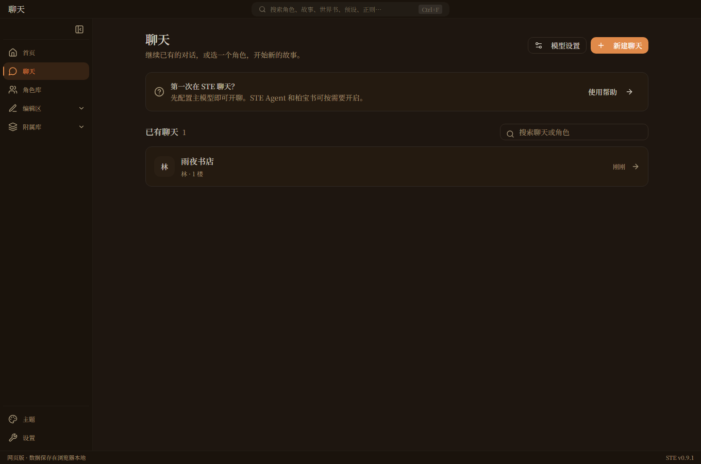
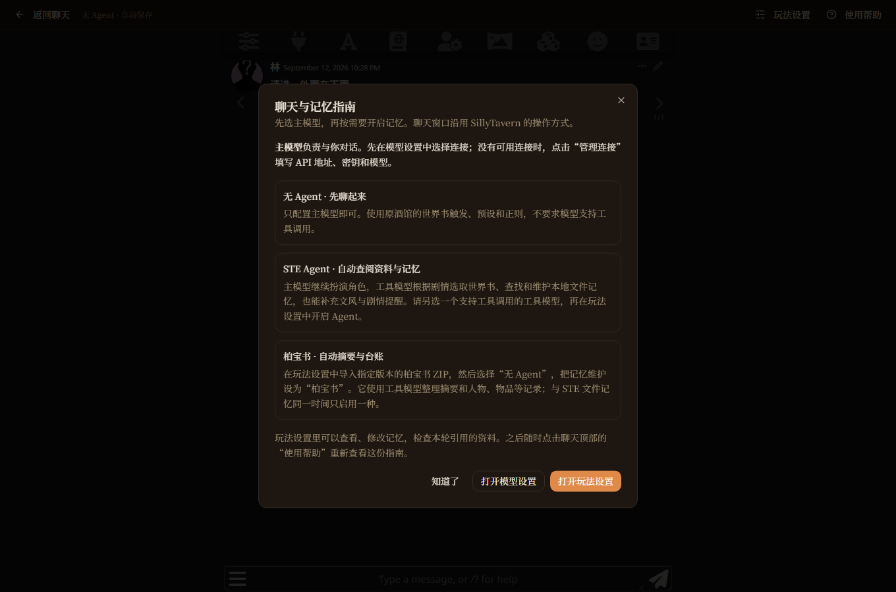

# STE 聊天体验修复与 Windows 验证

日期：2026-09-12。用户在 Windows 试玩程序中遇到发送、返回与关闭均报保存错误，同时反馈聊天入口和记忆功能缺少引导。本次继续沿用原版 SillyTavern 界面，在 `codex/ste-roleplay-runtime` 隔离工作树中完成修复。

## 用户能看到的变化

- 侧栏与移动导航新增 **聊天**。可以搜索、继续已有对话，或直接选择角色新开聊天；从这里进入会返回聊天列表。
- 首次聊天显示 **聊天与记忆指南**，说明主模型、无 Agent、STE Agent 与柏宝书的用法。顶部常驻 **玩法设置** 和 **使用帮助**，按钮直接打开实际模型与扩展设置。
- 保存失败显示具体原因，并提供 **重试保存**、**导出当前内容**、**退出聊天**。确认退出会执行此前的返回或 Windows 关闭操作。
- 恢复 JSONL 保留当前正文、候选、插件字段、未提交编辑和未发送输入；导出不依赖原故事能够写入。导入后输入会恢复到输入框。独立记忆文件不包含在恢复 JSONL 中。

操作说明见[游玩指南](../guides/roleplay.md)。以下截图使用合成测试角色与故事：

[查看窄屏聊天入口](ste-roleplay-ux-mobile.png)。

## 根因与修复

1. **新聊天保存假冲突。** 文件库原先只在异步写入前清缓存；写入期间的读取或迟到的读取可能重新缓存旧记录，使下一次保存被误判为并发编辑。加入逐记录缓存版本，并在写入结束后再次失效缓存。三个可控并发回归先复现失败、修复后通过；真实内容冲突保护保留。对应提交：`c494d97`。
2. **错误原因丢失，退出没有恢复路径。** 原版保存逻辑只读取空 `statusText`。宿主覆盖层现保留实际错误信息，STE 提供独立快照导出、保存重试与明确确认后退出。固定上游源码未直接修改。
3. **原生导出目标不在文件库时失败。** 旧流程选择保存位置后仍调用只允许授权目录的写入接口。新 Rust 命令在原生保存对话框中选取一个文件并原子写入，不扩大其所在目录的访问授权。
4. **自定义端口模型接口被拒绝。** Windows 实际请求暴露 HTTP scope 未覆盖自定义端口；已修正 HTTP(S) 地址模式，并通过本地端口接口完成一次真实 WebView2 请求。
5. **保存完成后窗口仍未关闭。** 实际 Tauri SDK 的 `onCloseRequested` 在允许关闭后调用 `destroy()`；原权限列表缺失 `core:window:allow-destroy`。补上主窗口权限，并用真实 SDK 与实际权限配置验证阻止和允许关闭两种状态。

## 自动检查

| 范围 | 结果 |
| --- | --- |
| 游玩、文件库、导航相关 Vitest | 30 个文件，233 项通过 |
| 原生导出桥接回归 | 2 项通过，覆盖成功、取消与写入错误 |
| 真实 Tauri SDK 关闭回归 | 1 项通过；补权限前复现失败 |
| 固定上游与来源覆盖层 | 48 项通过 |
| Rust 单元测试 | 44 项通过，1 项既有忽略，0 失败 |
| TypeScript 与受影响文件 lint | 通过 |
| 全项目 lint | 0 错误，1 个既有 Fast Refresh 警告 |
| 完整浏览器游玩套件 | 17/18 通过；聊天入口冷加载等待修正后，该项定向复跑通过 |
| 本次三项浏览器 UX 流程 | 全部通过，包含失败重试、恢复文件导入及设置入口 |
| 正常应用身份的 Windows 构建 | `npm.cmd run tauri -- build --debug --no-bundle` 成功 |

完整浏览器轮次中，新增聊天入口使用的 5 秒等待在开发服务器冷加载时超时，画面仍是 Suspense 加载状态。改用套件已有的 20 秒默认等待后，原功能断言全部通过，包括实际插件文件选择器和 390 px 导航；没有删除断言。其余浏览器流程覆盖原有 Agent、柏宝书、助手脚本、候选、分支和长聊天。

全项目 Rust 格式检查仍报告既有文件的格式差异，本次没有批量格式化无关文件。Rust 忽略项仍为需要 Windows 符号链接权限的既有用例。

## 实际 Windows 窗口验收

使用独立应用身份 `com.ste.explorer.roleplayuxcheck` 与隔离测试库，未向用户原库写入。测试操作真实 WebView2 窗口，经宿主调用 Rust 文件库；模型为本地夹具，只有一次生成请求，没有使用用户远端接口额度。

| 场景 | 实际结果 |
| --- | --- |
| 聊天入口 → 选角色 → 新聊天 | 原开场白保存，首次指南及两个设置快捷入口可用 |
| 发送 → 文件库保存 | WebView2 经自定义端口请求本地模型，回复持久化成功 |
| 未完成的消息编辑 → 返回 → 重开 | 编辑保存并正确恢复 |
| 正常 Windows 关闭 | 先保存，随后窗口确实关闭 |
| Windows 文件共享锁持续阻止写入 | 显示错误，当前编辑与输入仍可从独立快照读取 |
| 写入失败后确认返回 | 返回聊天列表，原故事文件逐字节保持不变 |
| 写入失败后确认关闭 | 窗口确实关闭，原故事文件逐字节保持不变 |

原生恢复导出的**保存对话框本身尚未端到端操作验收**；原生窗口中的快照内容已验证，选定目标的文件写入、取消和错误行为分别由 Rust 与前端桥接回归覆盖。浏览器下载恢复文件并重新导入的完整流程已通过。

测试进程已正常关闭。包含复制用户样本的原生调查文件与临时库保留在忽略目录，不进入源码提交。

## 交付程序与边界

交付文件：`src-tauri/target/debug/STE.exe`，49,309,184 字节，应用身份 `com.ste.explorer`。构建后检查二进制包含正常身份、不含隔离测试身份。

SHA-256：`C1EA6529F67F1DEE756140AF33D0DA91E09A3F9E8F0ACA1209136D8151098842`。

这是更新后的 Windows 试玩 exe，未发布安装包。需关闭旧程序后启动新文件；已经打开的旧窗口不会自动更新。正常身份的交付程序没有拿用户真实资料库再次启动测试。

Android 真机、原生导出对话框的完整操作、远端模型的剧情质量与缓存命中率仍不在本次验收结论内。原始功能与柏宝书适配边界见[首次接入记录](ste-roleplay-runtime-v1.md)及[扩展兼容说明](../principles/extension-compatibility.md)。
